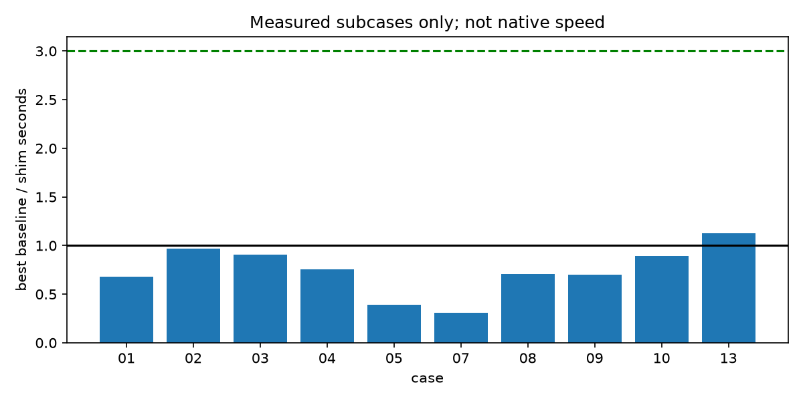

# Does a HEALPix/MOC extension matter for DuckDB?

This run yields 8 NO, 5 UNPROVEN. The project pass line is not met: 0 cases are MATTERS on capability or correctness (required: 3, including one beyond geography). Existing pixel keys and client-computed ranges provide strong baselines. Shim timings describe this Python implementation, not native extension speed. Several broad workloads remain UNPROVEN because the measured subcase does not establish the full claim; these are explicitly listed below. Scope down to validating the remaining MOC/HATS and native SQL-client claims before committing through Gate 5.

| Case | Verdict | Winning axis | Carrying number (baseline/shim at 10M unless noted) |
|---|---|---|---|
| 01 xmatch | NO | speed | 0.681014 |
| 02 moc-column | UNPROVEN | — | 0.966488 |
| 03 per-row-cones | UNPROVEN | — | 0.908567 |
| 04 adql-literal | NO | speed | 0.753192 |
| 05 sql-only | UNPROVEN | — | 0.38876 |
| 06 browser | UNPROVEN | — | 7902 bytes of generated SQL |
| 07 ingest | UNPROVEN | — | 0.311345 |
| 08 density | NO | speed | 0.708539 |
| 09 lightcurves | NO | speed | 0.703329 |
| 10 lake-partition | NO | speed | 0.890936 |
| 11 map-analysis | NO | — | case 8: 0.71785s (sql; scope evidence) |
| 12 distributed | NO | — | case 1: 22.8749s (neighbours; scope evidence) |
| 13 s2-h3 | NO | speed | 1.1293 |

Timing includes connection/UDF registration, input reads, candidate computation and result materialization. SQL-returning arms include the harness canonical sort; direct KD-tree baselines in cases 1 and 3 canonicalize only during validation outside the timer, a concession to those baselines. Python module startup and final fingerprinting are excluded. Each normal arm has three fresh-process trials; small cases have one trial per scale. Warm OS page cache is possible. Input catalogs are physically sorted by the level-29 key as requested; ingest ignores that key but inherits the spatial ordering. DuckDB uses four threads and disables `cte_filter_pusher` consistently for all main arms. Fixed-order cone coverage is expanded into order-12 buckets for hash joins; it is not left as a quadratic point-in-interval merge join. Orders/seed/versions are recorded in data/manifest.json, logs/setup.json and the lockfile. Exact integer row-set fingerprints are compared against independently computed Astropy/astropy-healpix oracles. Zero diff means equal row count and SHA-256; mismatches retain null diff count rather than an invented count. No native calibration was obtained.



## 01 — xmatch

A cone predicate does not by itself supply an efficient cross-match join.

| Without | With (shim) |
|---|---|
| <code>WITH a AS MATERIALIZED (SELECT *,cos(radians(&quot;dec&quot;))*cos(radians(ra)) AS x,cos(radians(&quot;dec&quot;))*sin(radians(ra)) AS y,sin(radians(&quot;dec&quot;)) AS z FROM cat),<br>        b0 AS MATERIALIZED (SELECT *,cos(radians(&quot;dec&quot;))*cos(radians(ra)) AS x,cos(radians(&quot;dec&quot;))*sin(radians(ra)) AS y,sin(radians(&quot;dec&quot;)) AS z FROM other),<br>        b AS (SELECT *,unnest([floor(&quot;dec&quot;*3600)::BIGINT-1,floor(&quot;dec&quot;*3600)::BIGINT,floor(&quot;dec&quot;*3600)::BIGINT+1]) AS bucket FROM b0)<br>        , candidates AS MATERIALIZED (SELECT a.id,b.id AS other_id,a.ra AS ara,a.&quot;dec&quot; AS adec,b.ra AS bra,b.&quot;dec&quot; AS bdec FROM a JOIN b ON floor(a.&quot;dec&quot;*3600)::BIGINT=b.bucket<br>        AND abs(a.x-b.x)&lt;=2*sin(radians(1./3600)/2)+1e-14<br>        AND abs(a.y-b.y)&lt;=2*sin(radians(1./3600)/2)+1e-14<br>        AND abs(a.z-b.z)&lt;=2*sin(radians(1./3600)/2)+1e-14) SELECT id,other_id FROM candidates WHERE sep(ara,adec,bra,bdec)&lt;=1./3600;<br></code> | <code>WITH a AS MATERIALIZED (SELECT *,cos(radians(&quot;dec&quot;))*cos(radians(ra)) AS x,cos(radians(&quot;dec&quot;))*sin(radians(ra)) AS y,sin(radians(&quot;dec&quot;)) AS z FROM cat),<br>        b0 AS MATERIALIZED (SELECT *,cos(radians(&quot;dec&quot;))*cos(radians(ra)) AS x,cos(radians(&quot;dec&quot;))*sin(radians(ra)) AS y,sin(radians(&quot;dec&quot;)) AS z FROM other),<br>        b AS (SELECT *,unnest([floor(&quot;dec&quot;*3600)::BIGINT-1,floor(&quot;dec&quot;*3600)::BIGINT,floor(&quot;dec&quot;*3600)::BIGINT+1]) AS bucket FROM b0)<br>        , candidates AS MATERIALIZED (SELECT a.id,b.id AS other_id,a.ra AS ara,a.&quot;dec&quot; AS adec,b.ra AS bra,b.&quot;dec&quot; AS bdec FROM a JOIN b ON floor(a.&quot;dec&quot;*3600)::BIGINT=b.bucket<br>        AND abs(a.x-b.x)&lt;=2*sin(radians(1./3600)/2)+1e-14<br>        AND abs(a.y-b.y)&lt;=2*sin(radians(1./3600)/2)+1e-14<br>        AND abs(a.z-b.z)&lt;=2*sin(radians(1./3600)/2)+1e-14) SELECT id,other_id FROM candidates WHERE sky_in_cone(ara,adec,bra,bdec,1./3600);<br></code> |

These are short SQL forms; the without cell can be a losing SQL arm. The fastest measured baseline and shim variant are named below. `bench.py:execute` is the executed source, including Python range construction and COPY setup. Shared `sep`/`point` macros and registration costs are not counted in these displayed query-line counts.

Evidence: [01-xmatch/result.json](cases/01-xmatch/result.json).

| Scale | Arm | Median seconds | Oracle row diff | Status |
|---|---|---|---|---|
| 1000000 | sql | 1.84612 | 0 | ok,ok,ok |
| 1000000 | python | 5.82021 | 0 | ok,ok,ok |
| 1000000 | neighbours | 3.10171 | 0 | ok,ok,ok |
| 1000000 | shim | 2.88694 | 0 | ok,ok,ok |
| 1000000 | shim_healpix | 25.366 | 0 | ok,ok,ok |
| 1000000 | geography | 8.12924 | 0 | ok,ok,ok |
| 10000000 | sql | 26.3422 | 0 | ok,ok,ok |
| 10000000 | python | 78.2938 | 0 | ok,ok,ok |
| 10000000 | neighbours | 22.8749 | 0 | ok,ok,ok |
| 10000000 | shim | 33.5894 | 0 | ok,ok,ok |
| 10000000 | shim_healpix | 191.523 | 0 | ok,ok,ok |
| 10000000 | geography | 90.3641 | 0 | ok,ok,ok |

Pure SQL possible: **yes**.  Displayed query lines: `{'without': 7, 'with': 7}`. Install: `{'without': ['duckdb'], 'shim': ['duckdb', 'pyarrow', 'cdshealpix', 'mocpy', 'astropy', 'numpy'], 'per_arm': {'sql': ['duckdb'], 'python': ['duckdb', 'scipy', 'numpy', 'pyarrow'], 'neighbours': ['duckdb', 'cdshealpix', 'numpy', 'pyarrow'], 'shim': ['duckdb', 'pyarrow', 'cdshealpix', 'mocpy', 'astropy', 'numpy'], 'shim_healpix': ['duckdb', 'pyarrow', 'cdshealpix', 'mocpy', 'astropy', 'numpy'], 'geography': ['duckdb', 'geography community extension']}, 'all_tested_arms': ['duckdb', 'pyarrow', 'numpy', 'scipy', 'astropy', 'astropy-healpix', 'cdshealpix', 'mocpy']}`.

**Skeptical objection:** A Python KD-tree or a proper neighbour-bucket join can beat these SQL joins.

**Answer:** The KD-tree is measured alongside SQL. The tested shim replaces the exact predicate, not the join operator. A separate HEALPix cone-to-bucket candidate arm is also measured, against a streamed CDS-neighbour baseline as well as KD-tree and pure SQL. Python MOC construction and native join performance are distinct; timed-out variants remain unverified and do not supply a speed ratio.

Best measured baseline: `neighbours`; best measured with arm: `shim`; baseline/shim ratio 0.681014. Subcase verdict: NO. Native calibration could change speed rankings; no factor was measured, so no verdict is flipped.

Baseline outcomes: `{"sql": "slower than selected baseline", "python": "slower than selected baseline", "neighbours": "selected fastest correct baseline", "geography": "slower than selected baseline"}`.

- Both materialized declination/chord candidates and per-row HEALPix cone-range candidates are tested. Python MOC construction is not native performance; no native join or calibration exists. pyacid is installed; the Python comparator uses SciPy directly.

[Benchmark chart](charts/01-xmatch.png)

## 02 — moc-column

Persisted multi-order cells can be joined using ordinary integer ranges.

| Without | With (shim) |
|---|---|
| <code>SELECT rid,count(*) FROM cat JOIN regions ON _healpix_29&gt;=lo AND _healpix_29&lt;hi GROUP BY rid;<br></code> | <code>WITH r AS (SELECT rid,unnest(moc_ranges(moc)) AS x FROM regions)<br>SELECT rid,count(*) FROM cat JOIN r ON _healpix_29&gt;=x.lo AND _healpix_29&lt;x.hi GROUP BY rid;<br></code> |

These are short SQL forms; the without cell can be a losing SQL arm. The fastest measured baseline and shim variant are named below. `bench.py:execute` is the executed source, including Python range construction and COPY setup. Shared `sep`/`point` macros and registration costs are not counted in these displayed query-line counts.

Evidence: [02-moc-column/result.json](cases/02-moc-column/result.json).

| Scale | Arm | Median seconds | Oracle row diff | Status |
|---|---|---|---|---|
| 1000000 | sql | 0.62225 | 0 | ok,ok,ok |
| 1000000 | shim | 0.583661 | 0 | ok,ok,ok |
| 10000000 | sql | 0.767805 | 0 | ok,ok,ok |
| 10000000 | shim | 0.794428 | 0 | ok,ok,ok |

Fixed 100000 ObsCore polygon supplement at order 8:

| Arm | Median seconds | Trial row differences |
|---|---|---|
| python_scalar | 13.1774 | 0, 0, 0 |
| python_batch | 3.74064 | 0, 0, 0 |
| shim | 10.4388 | 0, 0, 0 |

Fixed footprint workload, separate from catalog scales. MOC areas, not exact polygon areas. Each query is independently bounded at 300 seconds. Four-thread DuckDB and batch baseline. Timers exclude input loading and connection setup for this supplement.

Pure SQL possible: **yes**.  Displayed query lines: `{'without': 1, 'with': 2}`. Install: `{'without': ['duckdb'], 'shim': ['duckdb', 'pyarrow', 'cdshealpix', 'mocpy', 'astropy', 'numpy'], 'per_arm': {'sql': ['duckdb'], 'shim': ['duckdb', 'pyarrow', 'cdshealpix', 'mocpy', 'astropy', 'numpy']}, 'all_tested_arms': ['duckdb', 'pyarrow', 'numpy', 'scipy', 'astropy', 'astropy-healpix', 'cdshealpix', 'mocpy']}`.

**Skeptical objection:** SQL integer ranges already perform set operations; why add another coverage type?

**Answer:** The footprint supplement constructs all polygons and compares per-row intersection and union areas with direct MOCPy. Integer-range catalog joins are already SQL. Native column semantics and a portable SQL constructor remain unverified; no capability win is awarded.

Best measured baseline: `sql`; best measured with arm: `shim`; baseline/shim ratio 0.966488. Subcase verdict: NO. Native calibration could change speed rankings; no factor was measured, so no verdict is flipped.

Baseline outcomes: `{"sql": "selected fastest correct baseline"}`.

- Benchmark covers multi-order probability cells × catalog counts. Fixed 100k ObsCore construction, intersection and union are measured in the supplement. Pure-SQL polygon-to-MOC construction and a native MOC type remain unverified.

[Benchmark chart](charts/02-moc-column.png)

## 03 — per-row-cones

Per-row cones can be turned into SQL range joins without client orchestration.

| Without | With (shim) |
|---|---|
| <code>WITH c AS MATERIALIZED (SELECT *,cos(radians(&quot;dec&quot;))*cos(radians(ra)) AS x,cos(radians(&quot;dec&quot;))*sin(radians(ra)) AS y FROM cat),<br>            w0 AS MATERIALIZED (SELECT *,cos(radians(&quot;dec&quot;))*cos(radians(ra)) AS x,cos(radians(&quot;dec&quot;))*sin(radians(ra)) AS y,2*sin(radians(radius)/2)+1e-14 AS chord FROM watch),<br>            w AS (SELECT *,unnest(range(floor((&quot;dec&quot;-radius)*1000)::BIGINT,floor((&quot;dec&quot;+radius)*1000)::BIGINT+1)) AS bucket FROM w0)<br>            , candidates AS MATERIALIZED (SELECT wid,id,c.ra AS cra,c.&quot;dec&quot; AS cdec,w.ra AS wra,w.&quot;dec&quot; AS wdec,w.radius AS radius FROM c JOIN w ON floor(c.&quot;dec&quot;*1000)::BIGINT=w.bucket AND c.&quot;dec&quot; BETWEEN w.&quot;dec&quot;-w.radius AND w.&quot;dec&quot;+w.radius<br>            AND abs(c.x-w.x)&lt;=w.chord AND abs(c.y-w.y)&lt;=w.chord) SELECT wid,id FROM candidates WHERE sep(cra,cdec,wra,wdec)&lt;=radius;<br></code> | <code>WITH intervals AS MATERIALIZED (SELECT wid,ra,&quot;dec&quot;,radius,unnest(moc_ranges(moc_from_cone(ra,&quot;dec&quot;,radius,12))) AS x FROM watch),<br>        r AS (SELECT wid,ra,&quot;dec&quot;,radius,unnest(range(x.lo &gt;&gt; 34,x.hi &gt;&gt; 34)) AS bucket FROM intervals),<br>        candidates AS MATERIALIZED (SELECT wid,id,c.ra AS ara,c.&quot;dec&quot; AS adec,r.ra AS bra,r.&quot;dec&quot; AS bdec,r.radius FROM cat c JOIN r ON (c._healpix_29 &gt;&gt; 34)=r.bucket)<br>        SELECT wid,id FROM candidates WHERE sky_in_cone(ara,adec,bra,bdec,radius);<br></code> |

These are short SQL forms; the without cell can be a losing SQL arm. The fastest measured baseline and shim variant are named below. `bench.py:execute` is the executed source, including Python range construction and COPY setup. Shared `sep`/`point` macros and registration costs are not counted in these displayed query-line counts.

Evidence: [03-per-row-cones/result.json](cases/03-per-row-cones/result.json).

| Scale | Arm | Median seconds | Oracle row diff | Status |
|---|---|---|---|---|
| 1000000 | sql | 0.962716 | 0 | ok,ok,ok |
| 1000000 | python | 1.1223 | 0 | ok,ok,ok |
| 1000000 | ranges | 0.919663 | 0 | ok,ok,ok |
| 1000000 | shim | 1.17738 | 0 | ok,ok,ok |
| 1000000 | geography | 0.97034 | 0 | ok,ok,ok |
| 10000000 | sql | 3.07615 | 0 | ok,ok,ok |
| 10000000 | python | 10.725 | 0 | ok,ok,ok |
| 10000000 | ranges | 1.47461 | 0 | ok,ok,ok |
| 10000000 | shim | 1.62301 | 0 | ok,ok,ok |
| 10000000 | geography | 3.23225 | 0 | ok,ok,ok |

Pure SQL possible: **yes**.  Displayed query lines: `{'without': 5, 'with': 4}`. Install: `{'without': ['duckdb'], 'shim': ['duckdb', 'pyarrow', 'cdshealpix', 'mocpy', 'astropy', 'numpy'], 'per_arm': {'sql': ['duckdb'], 'python': ['duckdb', 'scipy', 'numpy', 'pyarrow'], 'ranges': ['duckdb', 'mocpy', 'astropy', 'pyarrow', 'numpy'], 'shim': ['duckdb', 'pyarrow', 'cdshealpix', 'mocpy', 'astropy', 'numpy'], 'geography': ['duckdb', 'geography community extension']}, 'all_tested_arms': ['duckdb', 'pyarrow', 'numpy', 'scipy', 'astropy', 'astropy-healpix', 'cdshealpix', 'mocpy']}`.

**Skeptical objection:** A client can generate the same ranges, and KD-trees support variable radii.

**Answer:** Both a KD-tree and client-generated HEALPix ranges are timed, including setup. The range algorithm is available without an extension; the comparison measures where its construction and execution occur.

Best measured baseline: `ranges`; best measured with arm: `shim`; baseline/shim ratio 0.908567. Subcase verdict: UNPROVEN. Native calibration could change speed rankings; no factor was measured, so no verdict is flipped.

Baseline outcomes: `{"sql": "slower than selected baseline", "python": "slower than selected baseline", "ranges": "selected fastest correct baseline", "geography": "slower than selected baseline"}`.

- Rubric gap: the best correct baseline is faster than the shim, but the closest correct SQL/S2 arm is 1.89534 times the shim time, outside the 1.5 band. No speed/code threshold is met. UNPROVEN is not a demonstrated extension win; native performance remains unmeasured.

[Benchmark chart](charts/03-per-row-cones.png)

## 04 — adql-literal

Literal cone ranges can be computed by a client before DuckDB runs.

| Without | With (shim) |
|---|---|
| <code>SELECT id FROM cat WHERE &quot;dec&quot; BETWEEN -.5 AND .5 AND sep(ra,&quot;dec&quot;,0,0)&lt;=.5;<br></code> | <code>WITH intervals AS (SELECT unnest(moc_ranges(moc_from_cone(0.,0.,.5,12))) AS x),<br>        pixels AS (SELECT unnest(range(x.lo &gt;&gt; 34,x.hi &gt;&gt; 34)) AS bucket FROM intervals),<br>        candidates AS MATERIALIZED (SELECT cat.* FROM cat SEMI JOIN pixels ON (_healpix_29 &gt;&gt; 34)=bucket)<br>        SELECT id FROM candidates WHERE sky_in_cone(ra,&quot;dec&quot;,0.,0.,.5);<br></code> |

These are short SQL forms; the without cell can be a losing SQL arm. The fastest measured baseline and shim variant are named below. `bench.py:execute` is the executed source, including Python range construction and COPY setup. Shared `sep`/`point` macros and registration costs are not counted in these displayed query-line counts.

Evidence: [04-adql-literal/result.json](cases/04-adql-literal/result.json).

| Scale | Arm | Median seconds | Oracle row diff | Status |
|---|---|---|---|---|
| 1000000 | sql | 0.623739 | 0 | ok,ok,ok |
| 1000000 | python | 0.758227 | 0 | ok,ok,ok |
| 1000000 | geography | 1.00292 | 0 | ok,ok,ok |
| 1000000 | shim | 0.658019 | 0 | ok,ok,ok |
| 10000000 | sql | 0.66435 | 0 | ok,ok,ok |
| 10000000 | python | 2.33001 | 0 | ok,ok,ok |
| 10000000 | geography | 0.902735 | 0 | ok,ok,ok |
| 10000000 | shim | 0.882046 | 0 | ok,ok,ok |

Local HATS fallback: `{"status": "ok", "source": "synthetic local HATS via lsdb.from_dataframe/to_hats", "input_rows": 10000, "selected_rows": 1003, "row_diff_count": 0, "seconds": 2.174406927000746, "partitions": 15, "shim_hats": {"selected_files": 4, "partition_diff_vs_client": 0, "partition_diff_vs_lsdb": 0, "row_diff_count": 0, "partitions": [[1, 16], [1, 17], [1, 18], [1, 19]]}, "geography_hats": {"input_files": 15, "row_diff_count": 0, "seconds": 0.02066243400076928}}`. Public attempts: `{"path": "https://data.lsdb.io/hats/gaia_dr3/gaia", "attempts": [{"status": "error", "error": "FileNotFoundError('Failed to read HATS at location https://data.lsdb.io/hats/gaia_dr3/gaia')"}, {"status": "error", "error": "FileNotFoundError('Failed to read HATS at location https://data.lsdb.io/hats/gaia_dr3/gaia')"}]}`.

Pure SQL possible: **yes**.  Displayed query lines: `{'without': 1, 'with': 4}`. Install: `{'without': ['duckdb'], 'shim': ['duckdb', 'pyarrow', 'cdshealpix', 'mocpy', 'astropy', 'numpy'], 'per_arm': {'sql': ['duckdb'], 'python': ['duckdb', 'mocpy', 'astropy', 'pyarrow', 'numpy'], 'geography': ['duckdb', 'geography community extension'], 'shim': ['duckdb', 'pyarrow', 'cdshealpix', 'mocpy', 'astropy', 'numpy']}, 'all_tested_arms': ['duckdb', 'pyarrow', 'numpy', 'scipy', 'astropy', 'astropy-healpix', 'cdshealpix', 'mocpy']}`.

**Skeptical objection:** A dynamic UDF range relation may prune less effectively than literal BETWEEN filters.

**Answer:** The client-generated literal filters are included, as is geography. Constant Parquet predicates can expose pruning opportunities that a UDF-produced range relation does not. The real Gaia check failed twice; the local HATS fallback is explicitly separate.

Best measured baseline: `sql`; best measured with arm: `shim`; baseline/shim ratio 0.753192. Subcase verdict: NO. Native calibration could change speed rankings; no factor was measured, so no verdict is flipped.

Baseline outcomes: `{"sql": "selected fastest correct baseline", "python": "slower than selected baseline", "geography": "slower than selected baseline"}`.


[Benchmark chart](charts/04-adql-literal.png)

## 05 — sql-only

The intended API simplifies SQL clients, but a Python shim does not validate delivery.

| Without | With (shim) |
|---|---|
| <code>-- Register the reusable macros in ../../plain_healpix.sql first.<br>SELECT * FROM plain_pixels(&#x27;cat&#x27;,12);<br></code> | <code>SELECT id,hpx_ang2pix(12,ra,&quot;dec&quot;) AS pix FROM cat;<br></code> |

These are short SQL forms; the without cell can be a losing SQL arm. The fastest measured baseline and shim variant are named below. `bench.py:execute` is the executed source, including Python range construction and COPY setup. Shared `sep`/`point` macros and registration costs are not counted in these displayed query-line counts.

Evidence: [05-sql-only/result.json](cases/05-sql-only/result.json).

| Scale | Arm | Median seconds | Oracle row diff | Status |
|---|---|---|---|---|
| 1000000 | sql | 1.53254 | 2/2/2 | ok,ok,ok |
| 1000000 | python | 1.54245 | 0 | ok,ok,ok |
| 1000000 | shim | 3.47409 | 0 | ok,ok,ok |
| 10000000 | sql | 10.2298 | 2/2/2 | ok,ok,ok |
| 10000000 | python | 8.05395 | 0 | ok,ok,ok |
| 10000000 | shim | 20.717 | 0 | ok,ok,ok |

Pure SQL possible: **no**. No oracle-correct pure-SQL route was established for the full stated use case; this is not a proof of mathematical impossibility. Displayed query lines: `{'without': 1, 'with': 1}`. Install: `{'without': ['duckdb'], 'shim': ['duckdb', 'pyarrow', 'cdshealpix', 'mocpy', 'astropy', 'numpy'], 'per_arm': {'sql': ['duckdb'], 'python': ['duckdb', 'cdshealpix', 'astropy', 'numpy', 'pyarrow'], 'shim': ['duckdb', 'pyarrow', 'cdshealpix', 'mocpy', 'astropy', 'numpy']}, 'all_tested_arms': ['duckdb', 'pyarrow', 'numpy', 'scipy', 'astropy', 'astropy-healpix', 'cdshealpix', 'mocpy']}`.

**Skeptical objection:** HEALPix is computable in SQL; lack of an implementation here is not impossibility.

**Answer:** The macro demonstrates pure-SQL feasibility but disagrees at the exact RA=0, Dec=0 boundary. That arm is preserved as xfail; a correct Python baseline prevents turning this into a win over the best baseline. Native CLI delivery remains unverified.

Best measured baseline: `python`; best measured with arm: `shim`; baseline/shim ratio 0.38876. Subcase verdict: UNPROVEN. Native calibration could change speed rankings; no factor was measured, so no verdict is flipped.

Baseline outcomes: `{"sql": "oracle mismatch, error or timeout; see trials", "python": "selected fastest correct baseline"}`.

- Python execution does not validate native CLI, dbt, R or Java delivery; the measured SQL macro has a boundary mismatch.

[Benchmark chart](charts/05-sql-only.png)

## 06 — browser

The no-extension browser path has a measurable JS and generated-SQL cost.

| Without | With (shim) |
|---|---|
| <code>-- Generate literal BETWEEN filters in the client. See without.py.<br></code> | <code>SELECT moc_ranges(moc_from_cone(0.,0.,0.5,12));<br></code> |

These are short SQL forms; the without cell can be a losing SQL arm. The fastest measured baseline and shim variant are named below. `bench.py:execute` is the executed source, including Python range construction and COPY setup. Shared `sep`/`point` macros and registration costs are not counted in these displayed query-line counts.

Evidence: [06-browser/result.json](cases/06-browser/result.json).

| Scale | Arm | Median seconds | Oracle row diff | Status |
|---|---|---|---|---|
| — | Not benchmarked | — | — | UNPROVEN |

Shipped ESM gzip: 19274 bytes; generated range predicate: 7902 bytes. Version and provenance in result.json.

Pure SQL possible: **no**. No oracle-correct pure-SQL route was established for the full stated use case; this is not a proof of mathematical impossibility. Displayed query lines: `{'without': 0, 'with': 1}`. Install: `{'without': ['duckdb'], 'shim': ['duckdb', 'pyarrow', 'cdshealpix', 'mocpy', 'astropy', 'numpy'], 'per_arm': {}, 'all_tested_arms': ['duckdb', 'pyarrow', 'numpy', 'scipy', 'astropy', 'astropy-healpix', 'cdshealpix', 'mocpy']}`.

**Skeptical objection:** Applications tree-shake JS; compressed source size is not load latency.

**Answer:** Objection stands. The measurement is one shipped ESM module, not application load latency; no browser or extension WASM measurement was performed.

Baseline outcomes: `{}`.

- No browser requested or used. Shipped ESM gzip size is not tree-shaken bundle cost; generated SQL uses MOCPy, not execution of JS library. WASM size/load time unverified.

## 07 — ingest

Ingest can move pixel computation into COPY, but Python already offers a vectorized route.

| Without | With (shim) |
|---|---|
| <code>-- Python registers Arrow table indexed(id,pix,ra,dec); see without.py.<br>COPY (SELECT * FROM indexed ORDER BY pix) TO &#x27;tmp/index.parquet&#x27; (FORMAT PARQUET, COMPRESSION ZSTD);<br></code> | <code>COPY (SELECT id,ra,&quot;dec&quot;,hpx_ang2pix(12,ra,&quot;dec&quot;) AS pix FROM cat ORDER BY pix)<br>TO &#x27;tmp/index.parquet&#x27; (FORMAT PARQUET, COMPRESSION ZSTD);<br></code> |

These are short SQL forms; the without cell can be a losing SQL arm. The fastest measured baseline and shim variant are named below. `bench.py:execute` is the executed source, including Python range construction and COPY setup. Shared `sep`/`point` macros and registration costs are not counted in these displayed query-line counts.

Evidence: [07-ingest/result.json](cases/07-ingest/result.json).

| Scale | Arm | Median seconds | Oracle row diff | Status |
|---|---|---|---|---|
| 1000000 | sql | 1.6712 | 2/2/2 | ok,ok,ok |
| 1000000 | python | 1.35495 | 0 | ok,ok,ok |
| 1000000 | shim | 2.54851 | 0 | ok,ok,ok |
| 10000000 | sql | 8.80288 | 2/2/2 | ok,ok,ok |
| 10000000 | python | 8.9254 | 0 | ok,ok,ok |
| 10000000 | shim | 28.6673 | 0 | ok,ok,ok |

Pure SQL possible: **no**. No oracle-correct pure-SQL route was established for the full stated use case; this is not a proof of mathematical impossibility. Displayed query lines: `{'without': 1, 'with': 2}`. Install: `{'without': ['duckdb'], 'shim': ['duckdb', 'pyarrow', 'cdshealpix', 'mocpy', 'astropy', 'numpy'], 'per_arm': {'sql': ['duckdb'], 'python': ['duckdb', 'cdshealpix', 'astropy', 'numpy', 'pyarrow'], 'shim': ['duckdb', 'pyarrow', 'cdshealpix', 'mocpy', 'astropy', 'numpy']}, 'all_tested_arms': ['duckdb', 'pyarrow', 'numpy', 'scipy', 'astropy', 'astropy-healpix', 'cdshealpix', 'mocpy']}`.

**Skeptical objection:** Arrow already avoids per-row Python overhead, and the native extension may behave differently.

**Answer:** The COPY arms preserve coordinates, compute pixels, sort and write Parquet. The Arrow baseline calls CDS on whole arrays; the shim processes DuckDB chunks. Without native calibration these are shim results only.

Best measured baseline: `python`; best measured with arm: `shim`; baseline/shim ratio 0.311345. Subcase verdict: UNPROVEN. Native calibration could change speed rankings; no factor was measured, so no verdict is flipped.

Baseline outcomes: `{"sql": "oracle mismatch, error or timeout; see trials", "python": "selected fastest correct baseline"}`.

- Raw coordinate ingest tested via Arrow Python and shim COPY; pure-SQL ang2pix included. Native speed and calibration unverified.

[Benchmark chart](charts/07-ingest.png)

## 08 — density

An existing level-29 key already contains every coarser density-map key.

| Without | With (shim) |
|---|---|
| <code>SELECT _healpix_29 &gt;&gt; 46 AS pixel,count(*) FROM cat GROUP BY 1;<br></code> | <code>SELECT hpx_parent(29,_healpix_29,6) AS pixel,count(*) FROM cat GROUP BY 1;<br></code> |

These are short SQL forms; the without cell can be a losing SQL arm. The fastest measured baseline and shim variant are named below. `bench.py:execute` is the executed source, including Python range construction and COPY setup. Shared `sep`/`point` macros and registration costs are not counted in these displayed query-line counts.

Evidence: [08-density/result.json](cases/08-density/result.json).

| Scale | Arm | Median seconds | Oracle row diff | Status |
|---|---|---|---|---|
| 1000000 | sql | 0.35769 | 0 | ok |
| 1000000 | shim | 0.441257 | 0 | ok |
| 10000000 | sql | 0.71785 | 0 | ok |
| 10000000 | shim | 1.01314 | 0 | ok |

Pure SQL possible: **yes**.  Displayed query lines: `{'without': 1, 'with': 1}`. Install: `{'without': ['duckdb'], 'shim': ['duckdb', 'pyarrow', 'cdshealpix', 'mocpy', 'astropy', 'numpy'], 'per_arm': {'sql': ['duckdb'], 'shim': ['duckdb', 'pyarrow', 'cdshealpix', 'mocpy', 'astropy', 'numpy']}, 'all_tested_arms': ['duckdb', 'pyarrow', 'numpy', 'scipy', 'astropy', 'astropy-healpix', 'cdshealpix', 'mocpy']}`.

**Skeptical objection:** Raw ra/dec still needs a pixel computation.

**Answer:** For indexed input, the strongest with arm is hpx_parent, shimmed as the same bit shift as SQL and checked against independent ang2pix output. Raw-coordinate pixel generation is measured in cases 5 and 7; it must not be charged again to an indexed density query.

Best measured baseline: `sql`; best measured with arm: `shim`; baseline/shim ratio 0.708539. Subcase verdict: NO. Native calibration could change speed rankings; no factor was measured, so no verdict is flipped.

Baseline outcomes: `{"sql": "selected fastest correct baseline"}`.


[Benchmark chart](charts/08-density.png)

## 09 — lightcurves

Position lookup is only one part of a light-curve lake.

| Without | With (shim) |
|---|---|
| <code>WITH selected AS (<br>SELECT id FROM cat WHERE &quot;dec&quot; BETWEEN -.5 AND .5 AND sep(ra,&quot;dec&quot;,0,0)&lt;=.5<br>)<br>SELECT p.id,p.epoch,p.flux FROM read_parquet(&#x27;data/phot-1000000.parquet&#x27;) p JOIN selected USING(id);<br></code> | <code>WITH selected AS (WITH intervals AS (SELECT unnest(moc_ranges(moc_from_cone(0.,0.,.5,12))) AS x),<br>        pixels AS (SELECT unnest(range(x.lo &gt;&gt; 34,x.hi &gt;&gt; 34)) AS bucket FROM intervals),<br>        candidates AS MATERIALIZED (SELECT cat.* FROM cat SEMI JOIN pixels ON (_healpix_29 &gt;&gt; 34)=bucket)<br>        SELECT id FROM candidates WHERE sky_in_cone(ra,&quot;dec&quot;,0.,0.,.5)) SELECT p.id,p.epoch,p.flux FROM read_parquet(&#x27;data/phot-1000000.parquet&#x27;) p JOIN selected USING(id);<br></code> |

These are short SQL forms; the without cell can be a losing SQL arm. The fastest measured baseline and shim variant are named below. `bench.py:execute` is the executed source, including Python range construction and COPY setup. Shared `sep`/`point` macros and registration costs are not counted in these displayed query-line counts.

Evidence: [09-lightcurves/result.json](cases/09-lightcurves/result.json).

| Scale | Arm | Median seconds | Oracle row diff | Status |
|---|---|---|---|---|
| 1000000 | sql | 0.497555 | 0 | ok |
| 1000000 | python | 1.03428 | 0 | ok |
| 1000000 | shim | 0.749469 | 0 | ok |
| 10000000 | sql | 0.632135 | 0 | ok |
| 10000000 | python | 2.53204 | 0 | ok |
| 10000000 | shim | 0.898776 | 0 | ok |

Pure SQL possible: **yes**.  Displayed query lines: `{'without': 4, 'with': 4}`. Install: `{'without': ['duckdb'], 'shim': ['duckdb', 'pyarrow', 'cdshealpix', 'mocpy', 'astropy', 'numpy'], 'per_arm': {'sql': ['duckdb'], 'python': ['duckdb', 'cdshealpix', 'astropy', 'numpy', 'pyarrow'], 'shim': ['duckdb', 'pyarrow', 'cdshealpix', 'mocpy', 'astropy', 'numpy']}, 'all_tested_arms': ['duckdb', 'pyarrow', 'numpy', 'scipy', 'astropy', 'astropy-healpix', 'cdshealpix', 'mocpy']}`.

**Skeptical objection:** Three deterministic epochs do not represent a production time-series workload.

**Answer:** A separate Parquet table with repeated epochs is joined by object id. The extension changes position selection, not the ordinary photometry join. Production temporal layout and varying epoch counts remain outside this small shortcut.

Best measured baseline: `sql`; best measured with arm: `shim`; baseline/shim ratio 0.703329. Subcase verdict: NO. Native calibration could change speed rankings; no factor was measured, so no verdict is flipped.

Baseline outcomes: `{"sql": "selected fastest correct baseline", "python": "slower than selected baseline"}`.

- Separate sorted Parquet photometry with three deterministic epochs per object; no production lake metadata or variable-length light curves.

[Benchmark chart](charts/09-lightcurves.png)

## 10 — lake-partition

A materialized HEALPix key already supplies partition columns.

| Without | With (shim) |
|---|---|
| <code>SELECT id,_healpix_29 &gt;&gt; 34 AS pix FROM cat;<br></code> | <code>SELECT id,hpx_parent(29,_healpix_29,12) AS pix FROM cat;<br></code> |

These are short SQL forms; the without cell can be a losing SQL arm. The fastest measured baseline and shim variant are named below. `bench.py:execute` is the executed source, including Python range construction and COPY setup. Shared `sep`/`point` macros and registration costs are not counted in these displayed query-line counts.

Evidence: [10-lake-partition/result.json](cases/10-lake-partition/result.json).

| Scale | Arm | Median seconds | Oracle row diff | Status |
|---|---|---|---|---|
| 1000000 | sql | 1.0609 | 0 | ok |
| 1000000 | python | 1.23339 | 0 | ok |
| 1000000 | shim | 1.08552 | 0 | ok |
| 10000000 | sql | 6.38265 | 0 | ok |
| 10000000 | python | 8.01127 | 0 | ok |
| 10000000 | shim | 7.16398 | 0 | ok |

Pure SQL possible: **yes**.  Displayed query lines: `{'without': 1, 'with': 1}`. Install: `{'without': ['duckdb'], 'shim': ['duckdb', 'pyarrow', 'cdshealpix', 'mocpy', 'astropy', 'numpy'], 'per_arm': {'sql': ['duckdb'], 'python': ['duckdb', 'cdshealpix', 'astropy', 'numpy', 'pyarrow'], 'shim': ['duckdb', 'pyarrow', 'cdshealpix', 'mocpy', 'astropy', 'numpy']}, 'all_tested_arms': ['duckdb', 'pyarrow', 'numpy', 'scipy', 'astropy', 'astropy-healpix', 'cdshealpix', 'mocpy']}`.

**Skeptical objection:** This does not test Iceberg or DuckLake metadata or write paths.

**Answer:** Both the plain SQL shortcut and the hpx_parent shim derive the sort/partition key from the existing level-29 key. Iceberg or DuckLake metadata is not involved in that calculation; actual storage-service integration was not tested.

Best measured baseline: `sql`; best measured with arm: `shim`; baseline/shim ratio 0.890936. Subcase verdict: NO. Native calibration could change speed rankings; no factor was measured, so no verdict is flipped.

Baseline outcomes: `{"sql": "selected fastest correct baseline", "python": "slower than selected baseline"}`.

- Materialized pixel column only; no Iceberg or DuckLake service tested.

[Benchmark chart](charts/10-lake-partition.png)

## 11 — map-analysis

The v1 API does not perform spherical harmonic analysis.

| Without | With (shim) |
|---|---|
| <code>-- No SQL spherical harmonic transform benchmark requested.<br></code> | <code>-- No v1 spherical harmonic API.<br></code> |

These are short SQL forms; the without cell can be a losing SQL arm. The fastest measured baseline and shim variant are named below. `bench.py:execute` is the executed source, including Python range construction and COPY setup. Shared `sep`/`point` macros and registration costs are not counted in these displayed query-line counts.

Evidence: [11-map-analysis/result.json](cases/11-map-analysis/result.json).

| Scale | Arm | Median seconds | Oracle row diff | Status |
|---|---|---|---|---|
| — | Not benchmarked | — | — | NO |

Evidence drawn from case 8:
- 1000000: sql 0.35769 seconds, shim 0.441257 seconds
- 10000000: sql 0.71785 seconds, shim 1.01314 seconds

Local aggregation/join timings do not establish transforms or distributed execution.

Pure SQL possible: **no**. No oracle-correct pure-SQL route was established for the full stated use case; this is not a proof of mathematical impossibility. Displayed query lines: `{'without': 0, 'with': 0}`. Install: `{'without': ['duckdb'], 'shim': ['duckdb', 'pyarrow', 'cdshealpix', 'mocpy', 'astropy', 'numpy'], 'per_arm': {}, 'all_tested_arms': ['duckdb', 'pyarrow', 'numpy', 'scipy', 'astropy', 'astropy-healpix', 'cdshealpix', 'mocpy']}`.

**Skeptical objection:** Map aggregation might still be useful even when transforms live elsewhere.

**Answer:** Case 8 measures aggregation, which is useful but is not a spherical harmonic transform. No harmonic API exists in the proposed v1 function table; no transform benchmark was requested.

Baseline outcomes: `{}`.

- Scope conclusion, not a benchmark-derived speed verdict. No harmonics or distributed execution implemented by the v1 API.

## 12 — distributed

The v1 API does not turn DuckDB into a distributed join engine.

| Without | With (shim) |
|---|---|
| <code>-- Use LSDB/Dask for distributed execution.<br></code> | <code>-- No v1 distributed executor.<br></code> |

These are short SQL forms; the without cell can be a losing SQL arm. The fastest measured baseline and shim variant are named below. `bench.py:execute` is the executed source, including Python range construction and COPY setup. Shared `sep`/`point` macros and registration costs are not counted in these displayed query-line counts.

Evidence: [12-distributed/result.json](cases/12-distributed/result.json).

| Scale | Arm | Median seconds | Oracle row diff | Status |
|---|---|---|---|---|
| — | Not benchmarked | — | — | NO |

Evidence drawn from case 1:
- 1000000: sql 1.84612 seconds, python 5.82021 seconds, neighbours 3.10171 seconds, shim 2.88694 seconds, shim_healpix 25.366 seconds, geography 8.12924 seconds
- 10000000: sql 26.3422 seconds, python 78.2938 seconds, neighbours 22.8749 seconds, shim 33.5894 seconds, shim_healpix 191.523 seconds, geography 90.3641 seconds

Local aggregation/join timings do not establish transforms or distributed execution.

Pure SQL possible: **no**. No oracle-correct pure-SQL route was established for the full stated use case; this is not a proof of mathematical impossibility. Displayed query lines: `{'without': 0, 'with': 0}`. Install: `{'without': ['duckdb'], 'shim': ['duckdb', 'pyarrow', 'cdshealpix', 'mocpy', 'astropy', 'numpy'], 'per_arm': {}, 'all_tested_arms': ['duckdb', 'pyarrow', 'numpy', 'scipy', 'astropy', 'astropy-healpix', 'cdshealpix', 'mocpy']}`.

**Skeptical objection:** A distributed system might embed DuckDB on each worker.

**Answer:** Case 1 is a single-node join measurement, not a scaling study. Case 4 checks only a small LSDB HATS selection. Neither supports claims about Rubin-scale distributed execution.

Baseline outcomes: `{}`.

- Scope conclusion, not a benchmark-derived speed verdict. No harmonics or distributed execution implemented by the v1 API.

## 13 — s2-h3

S2 already provides spherical distances; HEALPix/MOC interoperability is a separate claim.

| Without | With (shim) |
|---|---|
| <code>SELECT id FROM cat WHERE &quot;dec&quot; BETWEEN -.5 AND .5 AND s2_dwithin(point(ra,&quot;dec&quot;),point(0,0),radians(.5)*6371010);<br></code> | <code>WITH intervals AS (SELECT unnest(moc_ranges(moc_from_cone(0.,0.,.5,12))) AS x),<br>        pixels AS (SELECT unnest(range(x.lo &gt;&gt; 34,x.hi &gt;&gt; 34)) AS bucket FROM intervals),<br>        candidates AS MATERIALIZED (SELECT cat.* FROM cat SEMI JOIN pixels ON (_healpix_29 &gt;&gt; 34)=bucket)<br>        SELECT id FROM candidates WHERE sky_in_cone(ra,&quot;dec&quot;,0.,0.,.5);<br></code> |

These are short SQL forms; the without cell can be a losing SQL arm. The fastest measured baseline and shim variant are named below. `bench.py:execute` is the executed source, including Python range construction and COPY setup. Shared `sep`/`point` macros and registration costs are not counted in these displayed query-line counts.

Evidence: [13-s2-h3/result.json](cases/13-s2-h3/result.json).

| Scale | Arm | Median seconds | Oracle row diff | Status |
|---|---|---|---|---|
| 1000000 | geography | 0.554111 | 0 | ok,ok,ok |
| 1000000 | shim | 1.09148 | 0 | ok,ok,ok |
| 10000000 | geography | 0.873907 | 0 | ok,ok,ok |
| 10000000 | shim | 0.773848 | 0 | ok,ok,ok |

Local HATS geography-only scan (input file-list length, not a physical I/O profile): `{"input_files": 15, "row_diff_count": 0, "seconds": 0.02066243400076928}`.

Geography-only reruns (individual seconds; each compared to the original oracle):
- Case 1, 1000000: 7.72361 / diff 0, 8.33427 / diff 0, 8.12924 / diff 0
- Case 1, 10000000: 90.3641 / diff 0, 86.7358 / diff 0, 96.9076 / diff 0
- Case 3, 1000000: 0.760095 / diff 0, 1.99619 / diff 0, 0.97034 / diff 0
- Case 3, 10000000: 2.47428 / diff 0, 4.01013 / diff 0, 3.23225 / diff 0

Exact API boundary:
```text
SELECT hpx_ang2pix(12,0.,0.)
Catalog Error: Scalar Function with name hpx_ang2pix does not exist!
Did you mean "hamming"?

LINE 1: SELECT hpx_ang2pix(12,0.,0.)
               ^
```
```text
SELECT moc_from_cone(0.,0.,0.5,12)
Catalog Error: Scalar Function with name moc_from_cone does not exist!
Did you mean "to_microseconds"?

LINE 1: SELECT moc_from_cone(0.,0.,0.5,12)
               ^
```

Pure SQL possible: **yes**.  Displayed query lines: `{'without': 1, 'with': 4}`. Install: `{'without': ['duckdb'], 'shim': ['duckdb', 'pyarrow', 'cdshealpix', 'mocpy', 'astropy', 'numpy'], 'per_arm': {'geography': ['duckdb', 'geography community extension'], 'shim': ['duckdb', 'pyarrow', 'cdshealpix', 'mocpy', 'astropy', 'numpy']}, 'all_tested_arms': ['duckdb', 'pyarrow', 'numpy', 'scipy', 'astropy', 'astropy-healpix', 'cdshealpix', 'mocpy']}`.

**Skeptical objection:** S2 coverings and indexes could accelerate joins; this harness uses declination pruning.

**Answer:** The spherical predicate reruns test the existing S2 capability. Missing HEALPix/MOC functions establish an API boundary, not mathematical impossibility. S2-covering index joins remain unmeasured.

Best measured baseline: `geography`; best measured with arm: `shim`; baseline/shim ratio 1.1293. Subcase verdict: NO. Native calibration could change speed rankings; no factor was measured, so no verdict is flipped.

Baseline outcomes: `{"geography": "selected fastest correct baseline"}`.

- S2-only spherical predicates rerun with SQL declination pruning; S2 covering-index join not benchmarked. Missing HEALPix/MOC API is not proof no SQL implementation can be written.

[Benchmark chart](charts/13-s2-h3.png)

## What the cross-match non-goal costs

No verdict can honestly be changed for a hypothetical join operator. Case 1 measures a declination bucket join and KD-tree; it also measures per-row HEALPix cone ranges, but does not measure a native HEALPix neighbour join. The published function table also lacks a neighbour primitive: the shim bucket arm constructs per-row cones while the CDS baseline streams neighbours directly. A dedicated operator or neighbour primitive could reduce candidate generation and UDF overhead in cases 1 and 3, but both correctness and speed require a new benchmark. Case 12 still needs distributed orchestration.

## What geography already covers

The measured S2 distance predicates cover cones and cross-match distances, including wrap and polar inputs when oracle checks pass. Geography-only case 13 reruns identify the concrete API boundary: HEALPix conversion and MOC construction are absent from the installed function catalog. This does not prove no equivalent SQL/library composition exists. HATS partitions and IVOA MOC use a different cell encoding from S2. S2 covering joins, polygons and MOC interoperability were not exhaustively benchmarked.

## Public pitch

The three defensible topics to demonstrate next are MOC-valued coverage (case 2), per-row cone ranges (case 3), and HATS interoperability (case 4). These are proposed demonstrations, not three established wins. Drop claims that spherical predicates are unavailable in DuckDB, that density maps need an extension when a pixel key exists, that a shim proves WASM delivery, or that these measurements establish distributed/CMB capability.

## Reproduction and limitations

```bash
cd duckdb-healpix-value
uv sync --locked
uv cache clean --cache-dir .cache/uv  # keep the complete run below the disk cap
uv run python external_checks.py  # network checks, at most two Gaia attempts
uv run python run_all.py         # regenerate both scales, all arms, report/charts
uv run python verify.py         # full pytest, counts, and report refresh
uv run python run_all.py --report-only
```

One native build was attempted and stopped on a missing submodule; it did not test compilability. No second build or native load was attempted. To perform a proper recursive build (requires Rust and the exact DuckDB CLI):

```bash
git clone --recursive https://github.com/ejoliet/healpix-duckdb vendor/healpix-native
cd vendor/healpix-native
git checkout 9154587498af20e0e41279fb749f1651829cbe94
git submodule update --init --recursive
timeout 600 make
duckdb -unsigned -c "LOAD 'build/release/extension/healpix/healpix.duckdb_extension'; SELECT hpx_ang2pix(12,0.,0.);"
cd ../..
```

After locating the built artifact, calibration can be run with `uv run python calibrate.py --extension vendor/healpix-native/build/release/extension/healpix/healpix.duckdb_extension`. The artifact path must be checked against the build output. The optional script is supplied but unexecuted; no native build succeeded here.

The CLI must be v1.5.6. Full failed build log: logs/native-build.log. Upstream README snapshot: logs/upstream-README.md. No native-versus-shim calibration exists.

Unverified: native load, native calibration, browser/WASM, production ObsCore and time-series integration, Iceberg/DuckLake integration, native HEALPix-neighbour and S2-covering joins, pyacid performance, public Gaia query, spherical harmonics and distributed scaling. No skipped item is counted as a capability win. No test asserts correctness for an unexecuted arm.

Test evidence: `{"total": 143, "passed": 137, "xfailed": 6, "skipped": 0, "failed": 0, "exit_code": 0}`.
