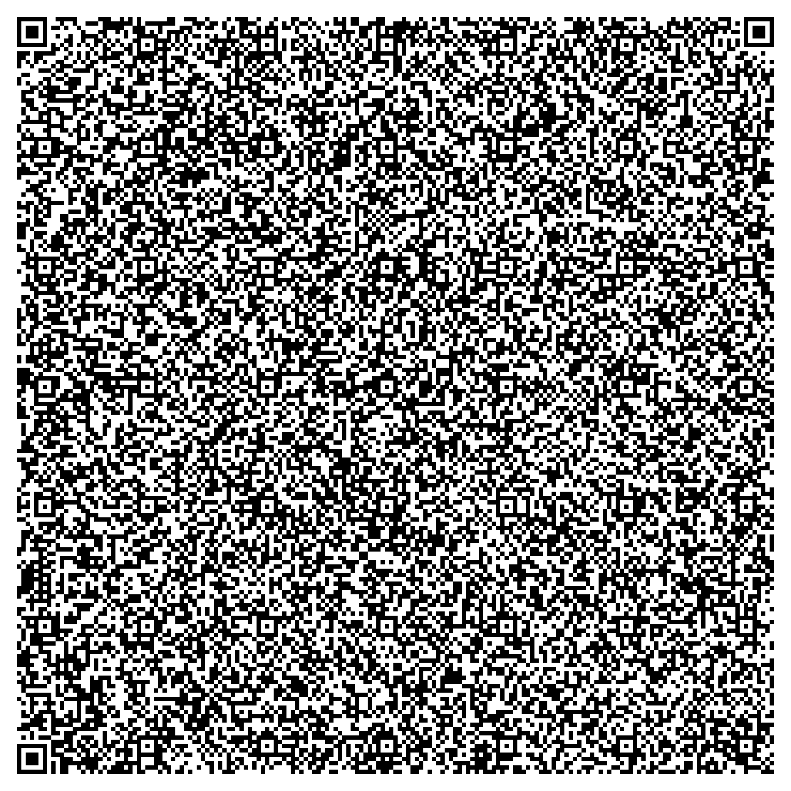
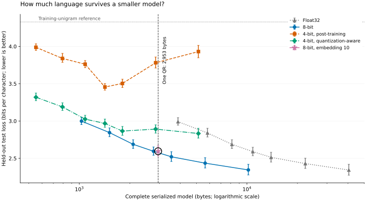

# A real language model in one QR code

**Yes: a trained neural character language model fits.** The selected model is a
20-unit GRU with **2,881 learned parameters**, stored in **2,952 bytes**
including all metadata. It scores **2.595 bits per character** on held-out
Alice text (character perplexity **6.04**), compared with **4.328** for a
training-frequency unigram reference. It produces spelling-like fragments and recognizable
rhythm, not coherent prose or useful answers. It is a real neural language model, **not a
large language model**, and not a Markov-chain text generator.

## Scan the model straight from this report



[Open the full-resolution QR for printing](artifacts/model-qr.png).
This is **model data, not a URL**. Open the [reader](index.html) in a browser served over
HTTPS or localhost, press **Start camera**, and point it at this code. A phone's ordinary
QR app will not run it; use this project's reader. The image is QR version **40-L**,
**177 × 177 modules**, with a four-module white quiet zone.
Print it at least **15 cm wide**, black on white, without cropping or smoothing the border.
A full-size screen image works too. Dense low-error-correction QR codes need good focus
and lighting; 15 cm is guidance, not a measured physical-print success threshold.

The theoretical limit is **2,953 binary bytes** in a version-40 QR at error-correction
level L, approximately 7% codeword recovery. It is **not** 3 KiB and is smaller at stronger
error correction. We encode one explicit byte-mode segment, with no base64, URL, compression,
or hidden external weights. Selected payload leaves **1 bytes** below that limit.
The PNG's file size is unrelated to QR payload capacity.

## Run the offline web reader

From the repository root:

```sh
python -m http.server 8000 --directory qr-code-llm
# Open http://localhost:8000/
```

1. Load the reader once and wait for **Reader saved for offline use**.
2. Disconnect from the network and reload the page.
3. Scan this QR with the camera, or use **choose a QR image** with a downloaded image/photo.
4. Enter a prompt, choose temperature and random seed, then generate 400 characters.

All camera processing and inference stay on your device. A service worker caches the reader,
including the vendored QR decoder. **It does not cache or fetch model weights.** Scanned weights
live only in memory. A reload clears them. Clearing browser site data removes offline support.
The first load must be online or served locally. Camera and service worker APIs require
HTTPS or localhost; opening `index.html` as a `file://` URL is not the supported path.
For a phone, serve this folder over HTTPS; a LAN HTTP address is not a secure camera origin.
The README and linked research artifacts are not part of the offline reader cache.
No server-side inference, CDN calls, WebGPU, or JavaScript ML framework is needed.

## Experiment

Corpus: Lewis Carroll's *Alice's Adventures in Wonderland*, Project Gutenberg ebook 11,
[UTF-8 source](https://www.gutenberg.org/files/11/11-0.txt). The original download and normalized text are included under
`data/`, with original Gutenberg license notice retained. The underlying 1865 text is public
domain in the United States; see the source's notice for its distribution terms.

We strip the front matter, table of contents, and Gutenberg footer; lowercase; map smart
quotes to apostrophes; transliterate to ASCII; map `!?;:` to periods; replace unsupported
characters with spaces; collapse repeated spaces and excess blank lines. The fixed
**31-character alphabet** is newline, space, apostrophe, comma, period, and `a`–`z`.
This simplification makes the task easier and limits what the model can emit.

Contiguous 80/10/10 split after normalization:
**114,061 training / 14,258 validation / 14,258 test characters**.
No training window crosses a split. Validation chooses checkpoints and the winning
serialized model; test loss is not used for selection. Test evaluation predicts each next
character once, with continuous recurrent state within the test split and a fresh zero
state at its beginning. Metrics exclude the first character of each evaluation split.

Architecture: a learned character embedding (10 dimensions in the selected
model), one GRU layer, and a learned
linear projection to vocabulary logits followed by softmax. The hidden state carries context
across characters. PyTorch's GRU convention is used:

```text
r = sigmoid(W_ir x + b_ir + W_hr h + b_hr)
z = sigmoid(W_iz x + b_iz + W_hz h + b_hz)
n = tanh(W_in x + b_in + r * (W_hn h + b_hn))
h_next = (1 - z) * n + z * h
logits = W_out h_next + b_out
```

We test hidden sizes **8, 12, 16, 20, 24, 33, and 48**, each with an 8-dimensional embedding, plus a 20-unit model with a 10-dimensional
embedding that fits in 2,952 int8 bytes. Each is trained from scratch with seed 1729. Adam, learning rate 0.004, batch size 32, sequence length 64, gradient clipping
at norm 1, **8,000 updates** per model. Training windows are sampled uniformly with
replacement, starting with zero hidden state. We check validation loss every 250 steps
and restore the best checkpoint. Every size receives the same update budget.

Each float checkpoint is exported as float32, symmetric per-tensor int8, and symmetric
per-tensor 4-bit. All seven tensors, including biases and embeddings, are quantized.
Scales are `max(abs(weights)) / (2^(bits-1)-1)`. Rounding uses nearest-even. The 4-bit
models receive **3,000 additional updates** of quantization-aware training (Adam
0.0008, straight-through gradient, dynamically recomputed detached scales), again choosing
the best validation checkpoint. This costs additional training and is not a controlled
same-compute comparison with the int8 models. We evaluate the actual exported and decoded
bytes, not an unquantized surrogate. `train.py` records every measured candidate, samples,
checkpoint validation history, corpus hashes, and environment version.

**Best means lowest validation BPC among the tested candidates that fit**, not a proof of
optimality over all architectures or training recipes. This is a single training seed;
architecture ranking could change with additional seeds, training, data, or quantization.
A larger 48-unit model supplies an over-budget reference. This is a small research sweep,
not an exhaustive hyperparameter search. An initial shorter sweep motivated adding the
20-unit int8 candidate; byte accounting then motivated its 10-dimensional embedding
variant. The table reports the final equal-budget training run.

## Quality versus size



Each point is one trained model/encoding, with **95% contiguous-block bootstrap intervals**
(512-character blocks, 2,000 resamples, seed 1729) over the held-out test loss. These are
approximate text-block uncertainty intervals, **not** uncertainty across training seeds.
No statistical significance claim is made. Lines connect hidden sizes within each encoding;
they are not an interpolation guarantee. The star is the additional embedding-10
int8 experiment; its other encodings are included in the table. The circled point is selected by validation.
The vertical line is the version-40-L capacity, and the horizontal reference is a unigram
frequency model used only as a baseline, never for generation.

| Hidden units | Embedding | Bits | Training stage | Parameters | Complete bytes | Validation BPC | Test BPC | Fits QR? |
| ---: | ---: | ---: | :--- | ---: | ---: | ---: | ---: | :--- |
| 8 | 8 | 32 | float | 959 | 3,879 | 3.009 | 2.991 | no |
| 8 | 8 | 8 | float | 959 | 1,030 | 3.017 | 2.999 | yes |
| 8 | 8 | 4 | float | 959 | 551 | 4.048 | 3.988 | yes |
| 8 | 8 | 4 | qat | 959 | 551 | 3.341 | 3.319 | yes |
| 12 | 8 | 32 | float | 1,443 | 5,815 | 2.852 | 2.840 | no |
| 12 | 8 | 8 | float | 1,443 | 1,514 | 2.853 | 2.845 | yes |
| 12 | 8 | 4 | float | 1,443 | 793 | 3.868 | 3.839 | yes |
| 12 | 8 | 4 | qat | 1,443 | 793 | 3.238 | 3.189 | yes |
| 16 | 8 | 32 | float | 2,023 | 8,135 | 2.699 | 2.688 | no |
| 16 | 8 | 8 | float | 2,023 | 2,094 | 2.702 | 2.688 | yes |
| 16 | 8 | 4 | float | 2,023 | 1,083 | 3.821 | 3.761 | yes |
| 16 | 8 | 4 | qat | 2,023 | 1,083 | 3.059 | 3.025 | yes |
| 20 | 8 | 32 | float | 2,699 | 10,839 | 2.580 | 2.590 | no |
| 20 | 8 | 8 | float | 2,699 | 2,770 | 2.585 | 2.595 | yes |
| 20 | 8 | 4 | float | 2,699 | 1,421 | 3.471 | 3.456 | yes |
| 20 | 8 | 4 | qat | 2,699 | 1,421 | 3.009 | 2.968 | yes |
| 24 | 8 | 32 | float | 3,471 | 13,927 | 2.505 | 2.514 | no |
| 24 | 8 | 8 | float | 3,471 | 3,542 | 2.513 | 2.521 | no |
| 24 | 8 | 4 | float | 3,471 | 1,807 | 3.579 | 3.504 | yes |
| 24 | 8 | 4 | qat | 3,471 | 1,807 | 2.897 | 2.866 | yes |
| 33 | 8 | 32 | float | 5,559 | 22,279 | 2.398 | 2.430 | no |
| 33 | 8 | 8 | float | 5,559 | 5,630 | 2.405 | 2.436 | no |
| 33 | 8 | 4 | float | 5,559 | 2,853 | 3.840 | 3.781 | yes |
| 33 | 8 | 4 | qat | 5,559 | 2,853 | 2.933 | 2.892 | yes |
| 48 | 8 | 32 | float | 10,119 | 40,519 | 2.275 | 2.344 | no |
| 48 | 8 | 8 | float | 10,119 | 10,190 | 2.279 | 2.345 | no |
| 48 | 8 | 4 | float | 10,119 | 5,131 | 3.987 | 3.930 | no |
| 48 | 8 | 4 | qat | 10,119 | 5,131 | 2.789 | 2.833 | no |
| 20 | 10 | 32 | float | 2,881 | 11,567 | 2.566 | 2.590 | no |
| 20 | 10 | 8 | float | 2,881 | 2,952 | 2.572 | 2.595 | yes |
| 20 | 10 | 4 | float | 2,881 | 1,512 | 3.545 | 3.536 | yes |
| 20 | 10 | 4 | qat | 2,881 | 1,512 | 2.897 | 2.893 | yes |

The 2,952-byte embedding-10 candidate has validation BPC 2.572
versus 2.585 for the 2,770-byte embedding-8 model. Their test BPC
differs by only 0.0003; this single-seed experiment does not
establish a held-out quality gain from the extra 182 bytes.
The final model is selected strictly by the stated validation rule.

The smallest quantization-aware model uses 551 bytes and scores
3.319 test BPC; the selected model uses 2,952 bytes and scores
2.595. Shrinking storage loses predictive quality overall, but the relationship
is not perfectly monotonic: bit depth and quantization training matter, not just unit count.
The selected architecture's float32 reference scores 2.590 BPC at
11,567 bytes. Raw data and every serialized candidate are in
[`artifacts/results.json`](artifacts/results.json) and [`artifacts/models/`](artifacts/models/).

Selected decoded model, prompt `alice `, temperature 0.8, PyTorch sampling seed 123,
320 generated characters (unfiltered):

```text
alice indy mouting kid you coof the gryn, 'it.'

'and the little wo.' said the to she che groubold the eyever the much they the eart groick.

'urr he can the fally it it, all woor,'

'smeshere it it
the went go it can't was when the fool.

'likees, and me of the dushld the she stiuster it treasing
the elgr of say say a vowon
```

All candidate samples are recorded, including failures. The browser uses a documented LCG
sampler rather than PyTorch's RNG, so its samples differ at the same seed; logits agree
within numerical tolerance. Lower temperature sharpens predictions but does not add
understanding, facts, or long-range coherence.

## Exact binary format: QLM1

All multibyte scalars are little-endian. Tensor values are row-major in PyTorch order.
The format includes sufficient information to reconstruct the network with this reader.
The generic architecture interpreter and scanner are supplied by the web app, not encoded
inside the QR — this experiment asks whether **trained model weights** fit on paper.

| Field | Bytes |
| :--- | ---: |
| ASCII `QLM1` magic/version | 4 |
| Bit depth, vocabulary length, embedding width, hidden width (`uint8` each) | 4 |
| ASCII vocabulary in token-index order | 31 |
| Seven tensors: embedding, GRU input weight, GRU recurrent weight, two GRU biases, output weight, output bias | variable |
| CRC-32 of all preceding bytes (IEEE polynomial) | 4 |

Each quantized tensor has one float32 scale followed by int8 bytes, or packed nibbles.
A 4-bit signed value `q` in -7…7 is stored as `q+8`; first value in the low nibble. Each
tensor pads its odd final nibble with 8 (zero). Float32 tensors omit the scale. GRU gates
are ordered reset, update, new. Parameter count is `V*E + 3*H*E + 3*H*H + 6*H + V*H + V`.
There is no learned initial hidden state. The browser validates magic, CRC, bounds,
vocabulary, exact length, scales, and finite values before allocating inference tensors.
CRC detects accidental corruption; it does not authenticate a model's author.

Selected artifact: `e10-h20-float-8bit`. SHA-256 of `artifacts/model.bin`:

```text
36bb1cdef519421b32d8e632e2b36066c19935a6ba59aa275852582550138324
```

Corpus SHA-256 (original): `a3a27f8edbf7fcd9b8ba8435494440e24952deaa3e2f2d65192d4cb7ca403754`

Corpus SHA-256 (normalized): `8426879a993c19565d2ce377ac3a6cf83c57416a385ba26c540edf5c64371529`

## Reproduce

Python 3.12, CPU PyTorch 2.15.0+cpu; exact dependency snapshot in
`requirements-lock.txt`. All commands below run inside `qr-code-llm`:

```sh
python -m venv .venv
.venv/bin/pip install -r requirements.txt
.venv/bin/python train.py --steps 8000 --qat-steps 3000 --hidden 8 12 16 20 24 33 48
.venv/bin/python train.py --steps 8000 --qat-steps 3000 --hidden 20 --embedding 10 --append
.venv/bin/python build_report.py
node test_model.cjs
.venv/bin/python test_browser.py
```

Training is CPU-only, single-threaded, with deterministic PyTorch algorithms enabled.
Numerical results may still vary across PyTorch versions and hardware. `requirements.txt`
uses the CPU wheel index for PyTorch. The browser tests use system Chromium by default;
set `CHROMIUM` to its executable path if needed. No dependency installation or corpus fetch
is needed to use the checked-in reader and QR. To rerun the experiment, the corpus is
already included. The vendored scanner is [jsQR 1.4.0](https://github.com/cozmo/jsQR), under
Apache-2.0; its license is in `vendor/jsQR.LICENSE`.

## Verification and limits

`test_model.cjs` checks all three supported bit depths, Python/JavaScript recurrent-state
and logit parity across a
multi-character sequence, deterministic generation, truncation, corrupt bytes, invalid
metadata, invalid scales, and invalid generation settings. `test_browser.py` exercises
image decoding, fake-camera capture of the actual final QR, generation, mobile layout,
and a service-worker-controlled reload with networking disabled followed by rescanning.
It asserts that no model binary is requested and that the service worker cache excludes
model artifacts. Test results and screenshots are in `artifacts/verification.json`,
`artifacts/reader-desktop.png`, and `artifacts/reader-mobile.png`.

**Physical paper, a real phone camera, and Safari/Firefox are not tested in this environment.**
The automated camera test uses an image of the final QR fed through Chromium's camera API.
Successful digital decoding does not guarantee a particular printer, camera, or lighting
setup. A large clean print and a full-resolution image import provide the best chances.
The model is intentionally tiny: it does not reliably retain sentence meaning, follow
instructions, or answer questions. The demonstrated result is a trained recurrent neural
network whose complete serialized parameters can be recovered from one QR and used offline.
