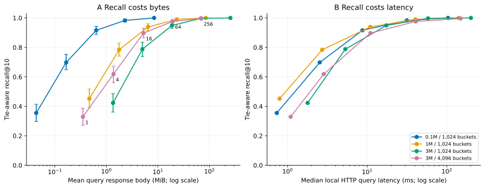
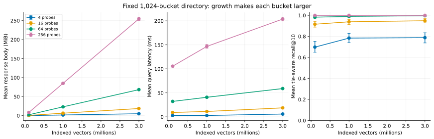
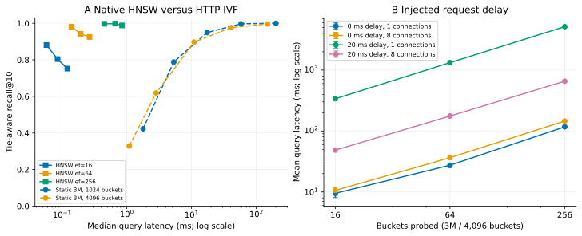

# staticvec: nearest-neighbour search over HTTP Range

This experiment builds an immutable vector index, serves it as ordinary static bytes, and searches it using a small Python client. The server has **no vector-search logic**. The experiment uses three million real DEEP1B image embeddings and compares the static client with an ordinary in-memory FAISS HNSW index and exact nearest neighbours.

## Result: it works, but high recall is expensive

**Yes: a vector index can be searched using only static HTTP Range requests.** In this implementation, querying three million vectors at **94.9% tie-aware recall@10 downloads 18.71 MiB**, with 17.39 ms median localhost latency. Reaching **99.7% costs 68.44 MiB and 58.06 ms**. An ordinary in-memory HNSW index reaches **98.8% at 0.85 ms** on the same vectors and queries. These are nearby operating points, not an interpolated equal-recall comparison.

The practical limit is bytes per useful answer and the number of requests. A small fraction of a gigabyte-scale index can still be tens of megabytes. Static hosting removes the search backend, but moves substantial data and computation to the client. It is plausible for occasional searches with tolerant latency and bandwidth budgets; these measurements do not support replacing an in-memory service for interactive, high-recall search on typical internet links.

Measured on 2026-11-09. Results below are the final run with both recall metrics recorded; an earlier exploratory run revealed the duplicate-vector issue described below.

### Three million vectors

| Method / setting | ID recall@10 | Tie-aware recall@10 | Mean body MiB | Mean requests | Median / p95 ms |
|---|---:|---:|---:|---:|---:|
| HNSW ef=16 | 0.744 | 0.752 | 0.00 | 0.0 | 0.12 / 0.17 |
| HNSW ef=64 | 0.917 | 0.925 | 0.00 | 0.0 | 0.27 / 0.39 |
| HNSW ef=256 | 0.980 | 0.988 | 0.00 | 0.0 | 0.85 / 1.09 |
| Static K=1,024, probes=16 | 0.941 | 0.949 | 18.71 | 15.8 | 17.39 / 24.06 |
| Static K=1,024, probes=64 | 0.989 | 0.997 | 68.44 | 60.2 | 58.06 / 70.19 |
| Static K=1,024, probes=256 | 0.990 | 1.000 | 254.78 | 192.2 | 200.88 / 241.31 |
| Static K=4,096, probes=16 | 0.891 | 0.897 | 5.24 | 15.9 | 10.97 / 14.34 |
| Static K=4,096, probes=64 | 0.970 | 0.976 | 19.24 | 63.0 | 40.79 / 49.23 |
| Static K=4,096, probes=256 | 0.990 | 0.996 | 69.54 | 240.0 | 149.08 / 165.87 |

Bytes and latency exclude directory startup. HNSW has zero network download because its full index is already resident in memory. Static timings include routing, actual HTTP transfers, NumPy distance computation and result merging. Averages use 100 queries; p95 is the empirical percentile, not a confidence bound.



*Left: mean response bytes versus tie-aware recall, with 95% bootstrap intervals for mean recall. Right: median latency versus mean recall. Each line sweeps 1, 4, 16, 64 and 256 probes; labels identify the 4,096-bucket sweep. n=100 queries per point.*

### Growth with a fixed directory

| Method / setting | ID recall@10 | Tie-aware recall@10 | Mean body MiB | Mean requests | Median / p95 ms |
|---|---:|---:|---:|---:|---:|
| 0.1M vectors, K=1,024, probes=16 | 0.916 | 0.916 | 0.63 | 15.7 | 8.71 / 10.98 |
| 1M vectors, K=1,024, probes=16 | 0.937 | 0.939 | 6.42 | 15.8 | 10.94 / 13.90 |
| 3M vectors, K=1,024, probes=16 | 0.941 | 0.949 | 18.71 | 15.8 | 17.39 / 24.06 |

From 100K to 3M, indexed rows increase 30× and query bytes increase **29.6×** at 16 probes. Recall does not collapse; **bandwidth scales almost linearly with corpus size** when the directory and probe count stay fixed. The near-constant metadata size does not make query cost constant.



*Fixed K=1,024; each line fixes a probe budget. Means with 95% bootstrap intervals across 100 queries per point. The byte curve is the clearest scaling failure; localhost hides much of its network cost.*

### Why it becomes expensive

**1. Coarse routing misses neighbours outside selected buckets.** For every exact top-10 ID, the diagnostic locates its bucket and ranks that bucket's centroid for the query. Across all 20 static configurations, the fraction covered by the selected centroids equals the measured tie-aware recall. This directly attributes the observed recall loss to routing. At 3M/K=1,024 the 95th-percentile true-neighbour bucket rank is 17 and the maximum is 146. At K=4,096 those ranks are about 33 and 775. Smaller buckets reduce bytes per probe but require more probes to cover difficult neighbours. Full float32 storage avoids a quantization error confound.

**2. Each visited bucket brings all its vectors.** There is no record-level search within a remote bucket. For dimension D=96, the measured body count is exactly:

```
query_bytes = 388 × number_of_vectors_in_selected_buckets
balanced_bucket_estimate = 388 × N × probes / K
startup_bytes = 64 + 384 × K + 8 × (K + 1)
```

At 3M/K=1,024/probes=16, the balanced estimate is 17.34 MiB; the measured mean is 18.71 MiB. Bucket imbalance and the query-selected bucket distribution account for the difference. At this point only about 1.69% of the payload is fetched, but that is still almost 19 MiB. IDs are only 4 of 388 bytes per row: deleting them would barely help.

**3. More buckets exchange bytes for requests and startup.** At 3M, K=4,096/probes=64 achieves 97.6% recall with 19.24 MiB, compared with K=1,024/probes=16 at 94.9% and 18.71 MiB. But it takes 63 versus 15.8 mean requests and 40.79 versus 17.39 ms median latency. At the high-recall end, the measured K=4,096/probes=256 point is worse than K=1,024/probes=64 in bytes, latency and recall. Increasing K is not an automatic improvement. The 4,096-centroid training uses 131,072 samples; FAISS warns that its recommended minimum is 159,744. This is an explicit tuning limitation, not a claim that this is the best possible partitioning.

**4. HTTP and scheduling overhead matter even on localhost.** Replacing only the client's HTTP fetch with local `pread`, retaining the same bucket selection, eight-worker executor, copying, NumPy distances and result merge, gives:

| 3M / 4,096 buckets | Local pread median ms | HTTP median ms |
|---|---:|---:|
| 16 probes | 2.52 | 10.97 |
| 64 probes | 8.73 | 40.79 |
| 256 probes | 33.63 | 149.08 |

This isolates a substantial transport/server/threading cost in this Python prototype. It is not a profiler-level decomposition, and the ablation runs in a later phase with warm files. Even the local path is much slower than native HNSW: both the search algorithm and the implementation differ. Eight connections are not optimal on a zero-delay local link: the 10-query control averages 117 ms with one connection versus 146 ms with eight at 256 probes. Concurrency earns its keep when requests have latency.

**5. Remote request latency magnifies the request count.** All requests are independent after routing, so concurrency helps, but does not remove the number of request waves:

| Injected delay / connections | 16 probes, mean ms | 64 probes, mean ms | 256 probes, mean ms |
|---|---:|---:|---:|
| 0 ms / 1 | 9.5 | 27.5 | 117.1 |
| 0 ms / 8 | 10.6 | 36.5 | 145.8 |
| 20 ms / 1 | 338.7 | 1324.9 | 5159.7 |
| 20 ms / 8 | 48.6 | 176.2 | 656.6 |

At 256 probes, coalescing still leaves about 240 requests. With eight connections that is roughly 30 waves; 20 ms per wave alone suggests around 600 ms, close to the measured 657 ms. With one connection the wait alone is roughly 4.8 seconds; the observed total is 5.16 seconds. These are measured injected delays, not public-internet benchmarks.



*Left: HNSW lines connect the 100K, 1M and 3M datasets at each efSearch; static lines are the 3M probe sweeps. Each point uses 100 queries. Right: 3M/K=4,096, 10 identical queries per setting; means with 95% bootstrap intervals. The two panels have different sample sizes. Local latency is not a WAN forecast.*

**6. Bandwidth and dimension impose additional limits.** As a model, not another measurement, transmitting 68.44 MiB at 100 Mbit/s requires **at least 5.74 seconds** before accounting for request latency or processing. At unchanged visited-row counts, 768-dimensional float32 records would cost `(4+4*768)/388 ≈ 7.93×` more bytes. Their actual routing/recall behaviour was not tested. The client eagerly queues fetches and may retain substantial completed payload buffers; its transient memory can approach query download size, in addition to the resident directory. Probing all buckets tends to downloading the entire index.

### The apparent recall failure that was actually a tie

Public query **449 has 57 bit-identical copies** in the 3M-vector prefix. More than ten IDs therefore have exactly zero distance. The exact search returns one set of ten, while static search or HNSW can return a different, equally correct set. In the final run, one static setting reports **0% ID recall for this query while returning ten zero-distance neighbours**. This caused a misleading 99% ceiling in the aggregate ID metric. No query was removed: the tables show strict ID recall alongside tie-aware recall, and the charts use the latter. The audit found 18 setting/query records where the metrics differ, all for this query. Returned IDs are retained so this explanation can be checked rather than accepted on trust.

### Startup, storage and construction

The 4,096-bucket directory costs **1,605,704 bytes (1.53 MiB)** and two dependent requests; the 1,024-bucket directory costs 401,480 bytes (0.383 MiB). These are one-time costs per opened client, not included in the warm-query tables. Ten cold application opens at 3M/K=4,096/probes=64 averaged **21.48 MiB total transferred** and had **45.02 ms median startup-plus-query latency**. That byte mean uses the 10-query subset, so it should not be compared with the 100-query warm mean by subtraction. OS caches remain warm.

| Vectors / buckets | Static object MiB | Static build seconds | HNSW arrays MiB | Cumulative HNSW build seconds |
|---|---:|---:|---:|---:|
| 0.1M / 1,024 | 37.39 | 3.45 | 50.39 | 4.15 |
| 1M / 1,024 | 370.41 | 5.66 | 503.79 | 70.36 |
| 3M / 1,024 | 1110.46 | 13.32 | 1511.39 | 256.65 |
| 3M / 4,096 | 1111.61 | 54.05 | 1511.39 | 256.65 |

HNSW array sizes count vectors, neighbours, offsets and levels, excluding allocator overhead and other process memory. Both 3M static variants compare with the same HNSW graph; its build is not repeated for K=4,096. Static build times include training, assignments and packing. Runtime data and index files remain available locally and are excluded from Git; the complete source and reproduction commands are below.

### What would be worth trying next

The evidence supports testing compressed bucket payloads or compact routing/scoring codes with a small full-vector rerank, hierarchical routing to control directory growth, and layouts that put likely co-visited data together. Persistent bucket caching may help repeated related queries. A graph-on-disk design could reduce distance evaluations but introduces dependent reads; this experiment does not measure one. These are proposed follow-ups, not measured improvements. Results beyond 3M rows, on text embeddings, in a browser, across a CDN, or under concurrent user load remain untested.

## Evidence and checks

- [Per-query measurements and returned IDs](results/queries.jsonl.gz): gzip-compressed JSONL, 2,900 main queries plus 120 delay measurements.
- [Aggregated statistics and confidence intervals](results/aggregate.json).
- [Routing, local-read, cold-start and duplicate diagnostics](results/diagnostics.json.gz).
- [Independent result audit](results/audit.json): recomputed both recall metrics from saved IDs, checked all IDs and payload accounting on all 2,900 main measurements.
- [Six passing correctness tests](results/tests.txt), including full-probe equality to brute force, exact range slices, partial reads, invalid queries, ignored Range responses, corrupt directories and duplicate-aware scoring.
- An additional **real-data exhaustive HTTP search** of the 100K index matched exact top-10, fetched 38,800,000 payload bytes and coalesced into one request.
- [Build statistics](results/builds.json), [built-index checksums](results/indexes.json), [dataset checksums](results/dataset.json), [run configuration and query IDs](results/environment.json); exact top-10 IDs and cutoff arrays are retained in `results/truth-*.npy` and `results/radius-*.npy`.

The checked-in compressed records can be plotted directly: `plot.py` reads the `.jsonl.gz` file if the uncompressed file is absent. Main results use a single dataset and 100 queries, one index build per configuration, and warm OS caches. These bounds are material: they support the reported prototype tradeoffs, not a general benchmark ranking of all vector index algorithms.

## What is implemented

The index is an inverted file (IVF): k-means partitions the vectors into buckets. A small resident centroid directory routes a query to its nearest `probes` centroids; the client fetches only those buckets and computes exact float32 distances within them. Increasing `probes` improves recall by searching more buckets. This layout makes the first query's data requests independent and parallelizable after loading the directory.

This is a purpose-built static IVF format, **not a serialized HNSW reader**. HNSW is the in-memory comparison. These results assess this implementation; they do not establish a lower bound for every static vector-search design.

- [format.py](format.py), [build.py](build.py): format, offline training and bucket packing.
- [client.py](client.py): NumPy and standard-library HTTP client; no FAISS at query time.
- [server.py](server.py): local HTTP/1.1 server implementing single-range `206` responses.
- [download.py](download.py): verified Range downloads of real data prefixes.
- [benchmark.py](benchmark.py): exact truth, HNSW, real HTTP queries, request-delay experiments.
- [diagnostics.py](diagnostics.py): routing attribution, local-read ablation, cold startup, exhaustive real-data validation.
- [plot.py](plot.py): aggregates and charts from per-query records.
- [test_staticvec.py](test_staticvec.py): format and HTTP correctness tests.
- [audit.py](audit.py): independently recompute recalls from retained result IDs and check byte accounting.

## Method

**Data.** The first 3,000,000 vectors of DEEP1B, 96-dimensional float32 learned image descriptors, with squared Euclidean distance. These are downloaded embeddings, not generated random vectors or artificially duplicated to reach scale. The [Big ANN benchmark's dataset definition](https://github.com/harsha-simhadri/big-ann-benchmarks/blob/main/benchmark/datasets.py) identifies the public files and metric. [Dataset provenance](results/dataset.json) records URLs, dimensions, counts and SHA-256 digests. The local fbin header is rewritten to the downloaded prefix count, so its checksum is for that prefix file rather than the billion-vector original.

**Queries and truth.** Download the first 1,000 separate public query vectors; select 100 without replacement with NumPy seed 2026. The same query IDs are used in every configuration. For each of 100,000, 1,000,000 and 3,000,000 indexed vectors, recompute exact top-10 using `faiss.IndexFlatL2` on that exact prefix. Recall@10 is the intersection with these ten IDs divided by ten, averaged across queries. HNSW is an approximation, not the truth oracle. Raw records also report overlap with HNSW at `efSearch=256`. Because real data contains duplicate embeddings, we additionally report **tie-aware recall**: the fraction of returned IDs whose squared distance is no greater than the exact top-10 cutoff plus an absolute `1e-7` tolerance. We recompute returned distances and the cutoff in float64 from the original coordinates. This accepts equivalent tied neighbours; it is a distance-threshold metric, distinct from strict ID intersection. Charts use tie-aware recall; tables retain both. This does not deduplicate or remove queries.

**Indexes.** HNSW uses `M=16`, `efConstruction=100`, and `efSearch` 16, 64 and 256. The same graph grows incrementally in 100,000-vector batches; its recorded build times are cumulative. Searches are single-query, single-threaded native FAISS calls. Static IVF uses 1,024 buckets at every size, plus 4,096 buckets at 3M; 15 k-means iterations, seed 42, and a random training sample of `min(N, max(65,536, 32*buckets))` indexed vectors. It keeps uncompressed float32 coordinates and original uint32 IDs. Four FAISS threads are used for offline work.

**Transport.** Each static query uses actual HTTP requests to a separate server thread on loopback. The client only receives the index URL; it cannot access the server file through its search API. It requires `206`, validates `Content-Range`, object size, content encoding and response length, and counts received response-body bytes. Up to eight connections fetch selected buckets concurrently. Physically adjacent selected buckets are coalesced without fetching intervening unselected buckets. No payload cache is retained between queries. Centroids and offsets stay resident; HTTP connections and the server's OS file cache are warm. These are not cold-disk or WAN measurements.

**Accounting.** Reported query bytes exclude startup metadata, response headers, HTTP request headers, TCP/IP and TLS. Response-header field bytes and request counts are separately recorded. There is no TLS on the local server. Thus this is measured downloaded application data, not a packet-capture estimate of total wire traffic. Cold application startup is measured separately. The delay experiment sleeps 20 ms before each response, allowing concurrent requests to overlap; it emulates an added per-request wait, not a complete WAN with bandwidth limits, packet loss or TLS handshakes.

**Machine and uncertainty.** Linux x86-64, AMD EPYC 9V74, 4 CPU cores of cgroup quota, 16 GiB memory limit; Python 3.12.14, NumPy 2.3.5, FAISS 1.13.2. [Environment and query IDs](results/environment.json) record the run. Error bars are percentile 95% bootstrap confidence intervals of query means, 2,000 resamples with seed 42. Main experiments have 100 queries per setting; delay and cold-start experiments have 10. These intervals describe variation across sampled queries, not across machines or index rebuilds. Parallel HNSW construction can vary between runs despite fixed input. Latency results come from one ordered sweep on a shared virtual machine.

## Binary format, version 1

One `.svx` object contains all data. All numbers are little-endian; vectors use IEEE float32; the fixed metric is squared L2. There is no compression, quantization, tombstone, mutation log or external ID table.

| Offset | Type | Meaning |
|---:|---|---|
| 0 | 8 bytes | ASCII `SVECIVF1` |
| 8 | uint32 | Format version, 1 |
| 12 | uint32 | Vector count N |
| 16 | uint32 | Dimension D |
| 20 | uint32 | Bucket count K |
| 24 | uint64 | Centroid offset, 64 |
| 32 | uint64 | Directory offset, `64 + 4*K*D` |
| 40 | uint64 | Payload offset, `directory + 8*(K+1)` |
| 48 | uint64 | Total object size |
| 56 | 8 bytes | Reserved padding |
| 64 | float32[K,D] | Centroids in bucket-ID order |
| directory | uint64[K+1] | Absolute start offsets plus final EOF sentinel |
| payload | packed records | Bucket-major `(uint32 ID, float32[D] vector)` |

A bucket `i` occupies `[offsets[i], offsets[i+1])`; empty buckets need no request. Each row is `4 + 4D` bytes (388 bytes here), with no padding. Original IDs are source row numbers, zero-based. The directory is checked for monotonicity, row alignment, payload start and EOF. The builder writes a temporary file and atomically renames it on completion. Serve completed objects at immutable/versioned URLs: the client pins size but does not detect same-size in-place replacement through an ETag. Do not overwrite a live object's contents.

Startup takes two dependent range requests: the 64-byte header, then all centroids and offsets. The metadata size is `64 + 4KD + 8(K+1)`: 401,480 bytes for K=1,024 and 1,605,704 bytes for K=4,096. Per-query work ranks the K centroids, downloads chosen buckets, computes exact distances, and merges each fetched span's top ten. No unvisited bucket's vector data is downloaded.

## Reproduce and use

Run inside this folder. All generated files and dependencies remain here; allow several GiB for the dataset and four indexes. Data, indexes and the environment are intentionally ignored by Git. The report, raw measurements, checksums, exact truth arrays and charts are versioned.

```sh
python -m venv .venv
.venv/bin/pip install -r requirements.txt
.venv/bin/python download.py
OPENBLAS_NUM_THREADS=1 OMP_NUM_THREADS=4 .venv/bin/python benchmark.py
OPENBLAS_NUM_THREADS=1 .venv/bin/python diagnostics.py
OPENBLAS_NUM_THREADS=1 .venv/bin/python audit.py
MPLCONFIGDIR="$PWD/.cache/matplotlib" .venv/bin/python plot.py
OPENBLAS_NUM_THREADS=1 .venv/bin/python -m unittest -v
```

The default run uses 3M vectors and 100 queries. `benchmark.py --sizes 100000 1000000 3000000 --queries 100 --probes 1 4 16 64 256` spells out the defaults. Downloads validate Range semantics and length and use an atomic rename; their resulting hashes are recorded. Downloading again reuses a complete local file by size. To verify identity against this report, compare its digest with the committed provenance before replacing that provenance in a fresh run.

Serve the built index independently:

```sh
.venv/bin/python server.py indexes --port 8000
```

In another terminal, a query with one real held-out vector:

```python
import numpy as np
from client import StaticIndex

q = np.memmap('data/query.public.10K.fbin', dtype='<f4', offset=8, shape=(1000, 96))[0]
index = StaticIndex('http://127.0.0.1:8000/deep-3000000-k4096.svx')
try:
    ids, stats = index.search(q, k=10, probes=64)
    print(ids, stats, index.startup)
finally:
    index.close()
```

For other data, write an fbin with two uint32 values `(N,D)` followed by row-major float32 vectors, then run:

```sh
.venv/bin/python build.py data/my-vectors.fbin indexes/my-vectors.svx --buckets 1024
```

The client also accepts a URL and a JSON coordinate array on its command line. It supports HTTP or HTTPS and bounds concurrent requests, but is deliberately a research client: no retry policy, authentication integration, browser implementation, shared cache, checksummed blocks or concurrent calls on the same `StaticIndex`. Deploying to another static host requires identity-encoded byte ranges; browsers would also need suitable CORS headers. The included server binds only to loopback and is for experiments.
