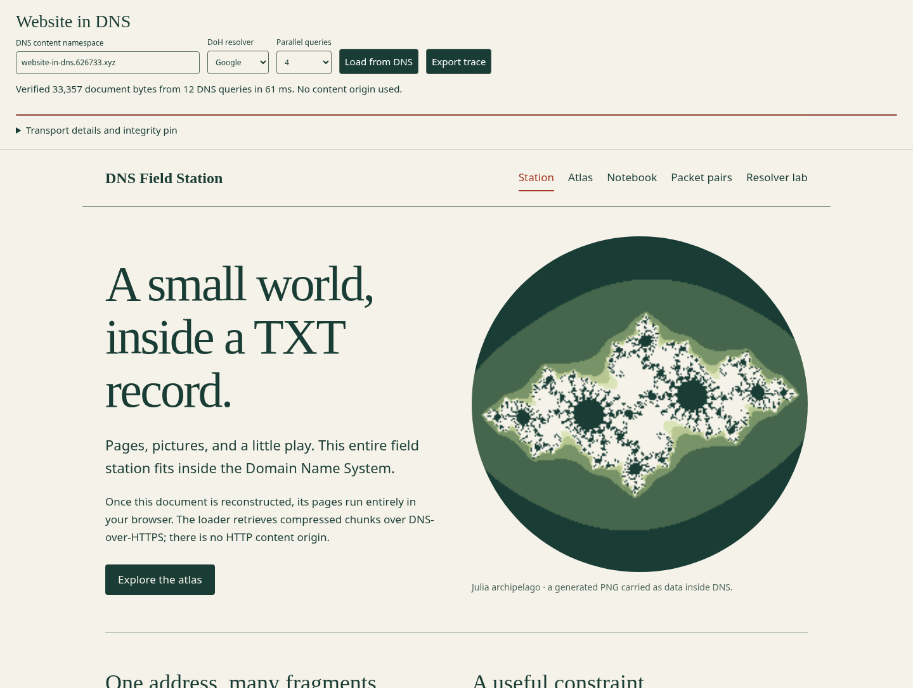

# Website in DNS

An interactive five-view website whose complete document—HTML, CSS, JavaScript, a PNG, and an SVG—is packaged into DNS TXT records. A small browser bootstrap retrieves the manifest and chunks using DNS-over-HTTPS, verifies their hashes, decompresses them, and runs the result in an isolated iframe.

**Status, 2026-11-09: implemented and browser-tested with intercepted DNS fixtures; real-domain publication is blocked.** The connected Cloudflare account exposes the active `626733.xyz` zone, but all three attempts to create an isolated probe record returned an authentication/retry message instead of a successful write. A follow-up read found no probe. Both Google and Cloudflare return NXDOMAIN for `_site.website-in-dns.626733.xyz`. Consequently, this is **not yet a demonstrated live website in DNS**, and there are **no measured live application load times or controlled payload-size ceilings**. The real resolver measurements below use existing public records; local capacity calculations and fixture tests are labeled separately. No result is silently replaced with local content.

The remaining step is to enable DNS write access, publish the prepared records, and run the controlled experiments. See [publication evidence](evidence/publication-blocker.json) and [live load attempts](evidence/app-live-attempt.json). No DNS records were successfully created during this run. A separate [live Chromium check](evidence/live-browser.json) confirmed that both public DoH APIs are accessible from the browser; the actual application manifest still returned NXDOMAIN.

## The app

Open [index.html](index.html), choose a resolver, and click **Load from DNS**. Until publication succeeds, the correct result is a visible load failure. The loader is self-contained and contains no application content or fallback bundle. The current release requires 12 DNS queries. Its expected manifest hash is pinned in the loader.

For a **local content preview only**, open [dist/app.html](dist/app.html). This preview is not evidence of DNS delivery. If your browser disallows local files, run `python3 -m http.server 8000 --directory .` from this folder and open `http://localhost:8000/dist/app.html`. For the real transport path, open `http://localhost:8000/index.html`; localhost then serves only the bootstrap. Managed Chromium in the research environment blocked `file:` navigation, so browser tests used this localhost pattern.

The views are:

- **Station:** explanation of how the reconstructed document works.
- **Atlas:** an embedded 4,539-byte Julia-set PNG and inline Lissajous SVG, generated reproducibly without external images or fonts.
- **Notebook:** seven searchable articles about TXT strings, transport, caching, compression, integrity, limitations, and the original project.
- **Packet pairs:** a complete 16-card matching game with shuffle, move counter, win state, restart, and keyboard controls. Game state stays in memory.
- **Resolver lab:** a live TXT inspector with Google/Cloudflare selection, raw answers, elapsed time, DNS status, and TTLs.

The app makes no external content requests when switching views, searching, or playing. The resolver inspector sends a query only when requested. Source links are explicit user navigation.

### Screenshots: fixture delivery, not live publication

The screenshots were captured with Playwright intercepting DoH and returning the generated TXT records. Their displayed load times are **fixture timings and must not be used as network measurements**.



[Mobile screenshot](evidence/mobile.png) · [Browser test results](evidence/browser-tests.json)

## Credit: the 2021 project

This experiment starts from **Company Directory / NUM**, posted by **Elliott (`elliottinvent`) and his team** as [“Show HN: DNS-powered website with no back end”](https://news.ycombinator.com/item?id=27598164) on **June 22, 2021**. The example linked to `companydirectory.uk/barclays.co.uk/contact-information`.

In [the author's introduction](https://news.ycombinator.com/item?id=27598165), Elliott explicitly says that all contact data comes from DNS TXT records via client-side Cloudflare DoH calls. NUM supplied conventions for company data; MODL and Unpacker handled compact serialization; the `company-api` TypeScript library exposed it to applications. The original example is credited for the DNS content delivery idea, not claimed as a new invention here. An [API snapshot of the attribution and introduction](evidence/original-project.json) is included.

This extension places the executable document and embedded image bytes in TXT records too. It is a separate tiny protocol, not an implementation of NUM.

## What “no content server” means

A normal browser cannot navigate to TXT records and execute them as a website. It first needs a bootstrap: this repository's approximately 10 KB `index.html`, obtained once by download, local filesystem, or ordinary static hosting. That bootstrap contains transport and loader UI code. **It is the explicit exception to “every byte in DNS.”** The entire app content, styling, scripts, and images are in the compressed DNS payload; the bootstrap does not fetch `dist/app.html`.

DNS authoritative servers and public HTTPS resolvers still exist. “No content server” here means no HTTP origin serving the app payload. It does not mean no servers, no infrastructure costs, or independence from DNS operators. DNS API access is needed at publishing time only; readers never receive a publishing credential.

## Format and implementation

1. `scripts/build.py` generates the images, embeds them into `src/app.html`, gzips the UTF-8 document with deterministic `mtime=0`, and base64-encodes the result.
2. Each numbered chunk is one TXT RR: `c0.<release>.<namespace>` contains `wd1:0:<base64-fragment>`. The release is `v` plus the first 20 hex characters of the compressed document's SHA-256.
3. `_site.<namespace>` contains `wd1:m:<base64-JSON>`. Its manifest specifies version, encoding, release, chunk count, compressed and decoded byte lengths, and the full compressed SHA-256.
4. The browser reads the manifest, checks its optional pinned SHA-256, fetches chunks with concurrency 1/2/4/8, restores numerical order, verifies length and hash, decompresses with `DecompressionStream`, and renders `srcdoc`.
5. Chunks are immutable, TTL 300; the manifest is mutable, TTL 60. Publish chunks first, manifest last. Retain prior releases beyond all old manifest TTLs plus a safety margin. The publisher refuses to replace a conflicting immutable chunk.

The zone export splits each RR into quoted character-strings of at most 255 ASCII bytes. The decoder joins strings **within one RR**, never unrelated RRs. It accepts both Cloudflare's quoted presentation and Google's bare TXT representation, including escaped characters. It filters by exact answer owner and TXT type. Missing, duplicate, truncated, corrupt, or oversized data fails visibly. Concurrent requests drain before a failed load can be retried.

The loader limits manifests to 1,024 chunks, 2 MiB compressed, and 8 MiB decompressed. These are **application safety bounds, not DNS capacity measurements**. Decompression is streamed with a length bound. The fetched document runs without same-origin privileges; it cannot read the parent DOM. CSP restricts network access to the two configured resolvers and blocks external scripts, fonts, and images. The pin establishes trust in a particular manifest; a hash stored only beside attacker-controlled data would not establish publisher identity. DNSSEC's AD flag is recorded by the measurement harness, but the app does not perform independent DNSSEC validation.

## Measurements actually made

Measurements were taken on 2026-11-09 from one managed Linux environment, through its inherited HTTPS proxy. Python 3.12 `urllib` opens a fresh HTTPS request/connection for each query. There is no application HTTP cache; requests ask for `Cache-Control: no-cache`. The proxy and resolver infrastructure are outside our control. Timings include connection, proxy, transport, and resolver work; they are **not isolated DNS service times**. These small samples are descriptive, not estimates of global performance.

### Existing public records: successful retrieval

Each latency cell below is the median of **five** queries. Google and Cloudflare use their JSON DoH APIs; Quad9 uses RFC 8484 wire format. Google and Cloudflare also received one separate wire-format cross-check for each name. Thus cross-resolver latency is not a perfectly controlled format comparison.

| Public name | TXT content bytes / RRs | DNS wire response bytes | Google median ms | Cloudflare median ms | Quad9 median ms |
|---|---:|---:|---:|---:|---:|
| `example.com` | 43 / 2 | 98 | 152.49 | 249.19 | 337.70 |
| `google.com` | 927 / 17 | 1,176 | 209.82 | 51.73 | 131.36 |
| `microsoft.com` | 3,886 / 61 | 4,710 | 71.14 | 43.97 | 74.64 |

All three returned the same content sizes and wire lengths for these names, without the DNS truncation flag. The 4,710-byte result demonstrates delivery beyond classic UDP and common EDNS payload budgets through DoH. It does **not** establish whether the recursive resolver used TCP upstream, because we did not capture that leg. It also does not demonstrate a 3,886-byte **single TXT RR**: this was a 61-record RRset, each with one string.

Larger answers were sometimes faster. That observation argues against fitting a simplistic “milliseconds per kilobyte” curve to these unrelated public names. Their cache state, authority, network path, and response format differ.

[Raw public responses and timing data](evidence/public-resolvers.json): 68 observations, comprising 60 repeated queries and 8 JSON-resolver wire cross-checks, including an additional NODATA case. All 68 had successful HTTP transport. Public verification strings in this file were obtained from public DNS, not local secrets.

### Cache behavior

- Google returned `Cache-Control: private, max-age=<remaining TTL>`. Quad9 returned `max-age=<remaining TTL>`. Cloudflare's tested JSON responses had no Cache-Control header. The wire cross-checks exposed CORS `Access-Control-Allow-Origin: *` for all three.
- In three deliberately spaced `example.com` observations, Google returned TTLs **300 → 300 → 298**; Cloudflare **300 → 52 → 300**; Quad9 **300 → 46 → 44**. Queries had a two-second pause after each response.
- For `microsoft.com`, the five back-to-back Google TTLs were **1629, 1629, 1929, 3243, 3574**. Cloudflare gave **2127, 598, 2127, 2127, 216**. These are compatible with requests reaching different cache instances and/or refreshes. We cannot infer a single cache lifetime from them.
- A fixed previously unqueried name is not a guaranteed cold query: recursive caches, shared egress, wildcard answers, and negative caching complicate that claim. No resolver cache was flushed. Fast replies are not themselves proof of a cache hit.
- HTTP `no-cache` / browser `no-store` does not flush recursive DNS caches. The app deliberately has no persistent browser content cache, making repeat DNS access visible.

The negative test under `example.com` returned **NOERROR with no TXT answer (NODATA)**, not NXDOMAIN. That distinction is preserved in the evidence rather than converted into an assumed failure. The dedicated `.invalid` test below supplies a genuine NXDOMAIN observation. Updating authoritative content and measuring stale-answer duration remains blocked by publishing access.

### Refusals and errors

| Test | Google | Cloudflare | Quad9 |
|---|---|---|---|
| `nonexistent-website-in-dns.invalid` | HTTP 200, DNS 3 (NXDOMAIN) | HTTP 200, DNS 3 | HTTP 200, DNS 3 |
| `dnssec-failed.org` | HTTP 200, DNS 2 (SERVFAIL) | HTTP 200, DNS 2 | HTTP 200, DNS 2 |
| 63-character label under `example.com` | HTTP 200, DNS 0, no TXT | Same | Same |
| 64-character label | HTTP 400 | HTTP 400 | Rejected locally by wire-query builder; no resolver request |
| `rs.dns-oarc.net` | NXDOMAIN | NXDOMAIN | NXDOMAIN |

The old DNS-OARC reply-size test name was unavailable in this run and provided no size-limit measurement. No DNS status 5 (REFUSED) or HTTP 429 was observed. We did not attempt to saturate resolvers or exhaust the user's zone quota. Invalid-label HTTP 400 is not a refusal of valid large TXT content.

[Raw edge cases and spaced TTL observations](evidence/edge-cases.json). These include 23 network queries and one local validation failure. With the eight manifest attempts, the stored CLI evidence contains **99 network queries** in total; earlier connectivity spot checks and the three separately recorded live-browser queries are not part of this CLI dataset.

## Local capacity results—not live DNS results

| Build component | Bytes / count |
|---|---:|
| Complete UTF-8 app document | 33,357 bytes |
| Embedded PNG before data-URL encoding | 4,539 bytes |
| Gzip document | 14,310 bytes |
| Base64 of gzip | 19,080 characters |
| Chunk payload budget | 1,800 base64 characters |
| Chunk records | 11 |
| Manifest records | 1 |
| Total first-load queries | 12 |

Gzip saves **57.1%** against the document; base64 adds **33.33%** to the compressed bytes. The final encoded payload is **57.2%** of the original document size before TXT framing and DNS/HTTPS overhead. PNG data appears twice in the HTML (home and atlas), but gzip shares its repeated text efficiently. There are no remote image URLs.

| Base64 characters per chunk | Chunks | Total queries | Dependency waves at concurrency 4 |
|---:|---:|---:|---:|
| 255 | 75 | 76 | 20 |
| 512 | 38 | 39 | 11 |
| 1,024 | 19 | 20 | 6 |
| 1,800 | 11 | 12 | 4 |
| 2,048 | 10 | 11 | 4 |
| 4,096 | 5 | 6 | 3 |
| 8,192 | 3 | 4 | 2 |
| 16,384 | 2 | 3 | 2 |

These rows are arithmetic, not evidence that a provider accepts each record size. The protocol prefix and TXT length octets add to each payload. At 1,800 characters the record content is about 1,806 bytes, split across eight TXT character-strings; this is a conservative candidate, not a measured optimum.

For the current 11 chunks, dependency depth is 12, 7, 4, or 3 query waves at concurrency 1, 2, 4, or 8. That explains why concurrency could help; it does not give a measured speedup. Multiplying by a hypothetical 100 ms per wave gives 1.2/0.7/0.4/0.3 seconds **as an illustrative model only**, excluding decompression and scheduling. The real app benchmark records failure at the manifest, so it cannot substantiate these numbers.

At this chunk size, each full record carries roughly 1,350 compressed bytes before framing. A **hypothetical** budget of 200 total records, reserving one manifest, carries at most 268,650 compressed bytes; 1,000 records carries 1,348,650 bytes. These are not claims about this account's Cloudflare quota. Record counts, existing zone usage, provider RDATA limits, and pricing must be checked before deployment. [Machine-readable local calculations](evidence/local-capacity.json).

## Which limits come first?

**Observed first blocker: publishing authentication.** There is no evidence yet that this provider rejects our selected TXT size. The connection allowed listing the zone and records but never completed a write. A Vercel fallback inventory contained no domains. This prevents satisfying the central real-domain requirement in this run.

Once publishing is available, likely constraints need separating:

| Layer | Constraint | Evidence level |
|---|---|---|
| DNS name | 63 octets per label; 255-octet wire name | Protocol; 63/64 label boundary observed |
| TXT string | 255 bytes per character-string | RFC 1035; local encoder/decoder tests |
| TXT RR / DNS message | Multiple strings allowed; RDLENGTH is 16-bit; the complete message must also fit transport framing and include headers, names, and other records | Protocol, not a tested maximum payload |
| UDP path | Classic 512-byte limit; EDNS sizes and fragmentation; TCP fallback may be needed | Protocol; no packet capture of resolver-to-authority leg |
| Managed DNS provider | Per-record content policy, record count, API limits, TTL minimum, zone plan | No controlled write/size results yet |
| Recursive resolver | Upstream transport, cache policy, validation, filtering | Public replies, TTLs, DNSSEC failure, and invalid names measured |
| Browser | Bootstrap, CORS, HTTPS, decompression support, sandbox, and memory | Fixture browser tests; wire CORS headers measured |
| Application design | Request fan-out, immutable releases, stale manifests, local-only state | Implemented; live latency and cache-update behavior outstanding |

DNS can distribute a small public interactive artifact. Nothing in the results supports treating it as unlimited free hosting, a streaming-media delivery network, or a writable application database. Increasing record count avoids a single-answer ceiling but increases lookup work and publishing complexity. For larger media, compression ratios stop rescuing the design. For updates, cache behavior becomes a correctness concern before bandwidth alone tells the story.

## Publish and finish the controlled experiment

Python scripts use only the standard library. Node 24 and Chromium were used for tests; the app itself has no framework or runtime package dependencies.

```sh
cd website-in-dns
python3 scripts/build.py --domain website-in-dns.626733.xyz --chunk-size 1800
python3 scripts/publish.py                         # inspect dry-run record plan

# Supply these through your environment/secret manager, never browser code:
# CF_API_TOKEN: DNS-edit token scoped to the chosen zone
# CF_ZONE_ID: ID of that zone
python3 scripts/publish.py --apply

# After the records resolve (including any negative-cache expiry):
python3 scripts/measure.py --mode app --repeats 5 --output evidence/app-published.json
```

The app benchmark checks byte-for-byte equality with the built document for Google and Cloudflare at concurrency 1, 2, 4, and 8. Publish only into a namespace you control. Changing the domain regenerates the zone file and loader pin automatically. API responses and created IDs are written to `evidence/publication.json`; no token is written to disk. The script stops on failed chunks before changing the manifest.

For controlled single-RR and RRset size tests:

```sh
python3 scripts/publish.py --probes                # review bounded probe plan
python3 scripts/publish.py --probes --apply --output evidence/probe-publication.json
python3 scripts/measure.py --mode limits --repeats 5 --output evidence/controlled-limits.json
```

The probe plan contains 14 single-RR sizes from 254 through 60,000 ASCII bytes, including 255/256 and 2048/2049 boundaries, plus RRsets of 2/4/8/16/32 records of 1,000 bytes. This is at most 76 probe records, not a quota-exhaustion test. Failed writes are captured as provider outcomes; querying a rejected/unpublished name is **not** a resolver size refusal. Correlate publication success with DNS results. A valid size-ceiling claim requires successful authoritative publication and repeated resolution attempts, not NXDOMAIN alone.

For update/caching tests after publication: use a dedicated mutable test record; capture existing value and TTL, replace its value without changing its name, query at fixed intervals through each resolver, and retain old/new payload hashes, timestamps, HTTP cache headers, and returned TTLs. Repeat using fresh names to reduce—but not claim to eliminate—cold-cache ambiguity. Do not reuse application chunk names. This mutation experiment was not run here.

For cleanup, use the IDs logged by the publisher to remove only this experiment's records after reviewing the list. There is deliberately no broad “delete zone” or suffix-wide cleanup command. Avoid removing old application chunks while cached manifests can still reference them.

## Tests and reproducibility

```sh
python3 scripts/build.py
node tests/protocol.test.cjs
python3 tests/wire_test.py
# Browser tests need Playwright and Chromium; e.g. npm install in this folder.
node tests/browser.cjs

python3 scripts/measure.py --mode public --repeats 5 --output evidence/public-rerun.json
python3 scripts/edge_cases.py
node tests/live-browser.cjs
```

Six JavaScript protocol tests and three Python DNS-wire tests passed. Browser tests passed reconstruction, the exact initial query count, all five routes without extra content requests, search and its empty state, game completion/restart, mobile overflow, keyboard tile activation, inspector submission/display, parent-DOM isolation, HTTP failure, missing chunks, corruption, duplicate protocol answers, and absence of uncaught JavaScript errors. The browser suite intercepts DoH and explicitly records that fact. It is not a substitute for a live deployment test.

`dist/records.json`, `dist/zone.txt`, and `index.html` are generated artifacts; edit `src/` and rebuild. A reproducible build means the same source and Python/zlib environment produce the same payload. A different compressor version can produce different bytes, appropriately generating a new release hash.

### File map

| Path | Purpose |
|---|---|
| `src/app.html` | All app content, style, interactions, image placeholders |
| `src/loader.html`, `src/transport.js` | Generic bootstrap and protocol decoder |
| `scripts/build.py` | Deterministic image generation, bundle, DNS export, loader |
| `scripts/publish.py` | Namespace-scoped publisher and bounded size probes |
| `scripts/measure.py` | JSON/wire DoH measurements and verified app retrieval |
| `tests/` | Protocol, wire, and browser checks |
| `dist/` | Built content, DNS records, zone file, byte counts |
| `evidence/` | Raw measurements, blocker, fixture checks, screenshots |

### Standards and references

- [RFC 1035, §3.3.14 and §2.3.4](https://www.rfc-editor.org/rfc/rfc1035): TXT representation and size limits.
- [RFC 6891](https://www.rfc-editor.org/rfc/rfc6891): EDNS and UDP payload size.
- [RFC 7766](https://www.rfc-editor.org/rfc/rfc7766): DNS over TCP.
- [RFC 8484](https://www.rfc-editor.org/rfc/rfc8484): DNS over HTTPS and HTTP caching.
- [RFC 2308](https://www.rfc-editor.org/rfc/rfc2308): negative DNS caching.
- [Google JSON DoH API](https://developers.google.com/speed/public-dns/docs/doh/json).
- [Cloudflare DNS record types](https://developers.cloudflare.com/dns/manage-dns-records/reference/dns-record-types/): TXT presentation and quoting.

A fresh independent review identified and verified a correction for raster aspect ratio; inspector submission and keyboard activation were subsequently added to browser coverage.

The experiment remains incomplete until its own records are published and the controlled measurements replace the explicit gaps above.
